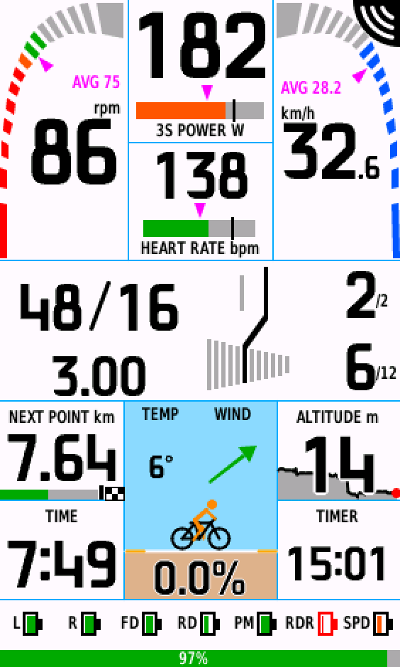

# Lazy Dashboard

[Connect IQ ストア](https://apps.garmin.com/apps/6b6fd786-e6ac-4419-9f56-75a55b97b7a3) · [English manual](README.md) · [한국어 설명서](README.ko.md) · [繁體中文說明](README.zh-TW.md)

機械式コンポの自転車には **[Lazy Dashboard – Mechanical](mechanical/README.ja.md)**：スピードとケイデンスからギアを推定して表示します。



このリポジトリには取扱説明書だけがあります。ご質問・不具合のご報告は開発者のメール [lazyfrmr@gmail.com](mailto:lazyfrmr@gmail.com) までお送りください（日本語で大丈夫です）。

Garmin Edge 用の Connect IQ データ項目です。ケイデンス・スピード・パワー・心拍、ドライブトレイン（ギアとクロスチェーン
の案内）、風・勾配・高度、コースナビゲーション、各パーツのバッテリーを 1 つの画面にまとめて表示します。SRAM AXS で
検証しています。Shimano Di2 はギア表示に対応しています（Di2 のバッテリーは Garmin がアプリに値を渡さないため表示できません）。

> **画面の表示言語について：** アプリの画面は日本語・英語・韓国語・中国語（繁体字）で表示できます（日本語は 1.3.0 から）。
> 設定 [言語] が [自動] ならデバイスの言語に合わせます。この説明書では画面の表示を `気温` のように書きます。
>
> メニュー名は Garmin の日本語操作マニュアル（Edge 1040：2025 年 4 月版、Edge 530）に合わせています。機種やソフトウェアの
> バージョンによって少し異なる場合があります。

---

## 1. 対応機種

| 機種 | 画面 | Lazy Digits（大きな数字フォント） |
|---|---|---|
| Edge 1040 / 1050 / 1060 | フルレイアウト | あり |
| Edge 550 / 850 | フルレイアウト | あり |
| Edge 1030 / 1030 Plus / 1030 Bontrager | フルレイアウト | なし（システムの数字フォント） |
| Edge 540 / 840 | コンパクト（数字中心） | あり |
| Edge 530 / 830 | コンパクト（数字中心） | なし（システムの数字フォント） |
| Edge 520 Plus | コンパクト（数字中心） | なし（システムの数字フォント） |

- **Lazy Digits** はアプリに内蔵した数字フォントです。540/840、550/850、1040、1050、1060 はデバイスの言語を日本語（中国語・韓国語・
  タイ語も同じ）にすると、Connect IQ アプリが使える数字フォントが小さな固定サイズに切り替わります。Lazy Digits を使うので、
  言語に関係なく数字が大きく表示されます。ほかの機種はどの言語でも数字の大きさが変わらないため、システムのフォントを使います。
  フォントはオープンライセンス（OFL）で公開しています：https://github.com/bwchae/lazy-digits
- Edge 520 Plus は変速機の情報をアプリに渡さないため、変速機のバッテリーは表示できません（ギアは表示）。初代 Edge 520、
  Edge 1000 には対応していません。
- 必要なソフトウェア：Edge 1040 は **31.35 以降**、1050・850・550 は **32.20 以降**。インストール時にソフトウェアの更新を
  求められたら、Garmin Express またはデバイスのシステム設定で更新してからインストールしてください。

## 2. インストールとアップデート

1. スマートフォンに Garmin の **Connect IQ** アプリをインストールし、Edge と接続します。
2. Connect IQ アプリで **Lazy Dashboard** を検索してインストールします。
   ストア：https://apps.garmin.com/apps/6b6fd786-e6ac-4419-9f56-75a55b97b7a3
3. Edge がスマートフォンと同期するとアプリが転送されます。3 章の手順でトレーニングページに追加してください。

アップデートは Edge がスマートフォンと同期したときに届きます（Connect IQ アプリで自動アップデートをオフにしている場合は、
アプリから手動で更新してください）。設定はアップデート後もそのまま残ります。

**1.3.0 へのアップデート：** オンライン風のために 2 つの権限（バックグラウンド、通信）が追加されます。ストアでは
インターネットでデータを送受信する権限として表示されます。Connect IQ アプリが権限の許可を求めたら **許可** を
タップしてください。アップデートがインストールされます。許可画面に権限名が表示されないことがありますが（Connect IQ
アプリの既知の問題）、この権限のことです。外部に送るのは約 5 km 単位に丸めた位置だけで（10 分ごとにスマートフォン
経由で Open-Meteo へ）、個人を特定できる情報は送りません。設定 **オンライン風** でオフにできます。

## 3. トレーニングページに追加する

**Edge 1040（ほかのタッチパネル機種も同様）**
1. ホーム画面からメニュー ＞ [ライドプロフィール] をタップし、プロフィールを選びます。
2. [トレーニングページ] ＞ [追加] ＞ [トレーニングページ] の順にタップします。
3. データ項目のカテゴリーから **Connect IQ ＞ Lazy Dashboard** を選びます。
4. ページ分割のパターンは **1 分割**（データ項目 1 つ）を選び、チェックをタップして完了します。

**Edge 530 / 830**
1. ホーム画面から [メニュー] ＞ [設定] ＞ [アクティビティプロフィール] を選び、プロフィールを選びます。
2. [トレーニングページ] ＞ [新規追加] ＞ [トレーニングページ] を選びます。
3. データ項目のカテゴリーから **Connect IQ ＞ Lazy Dashboard** を選び、[完了] を選びます。

> 必ず **1 分割**のページに入れてください。複数の項目があるページに入れると、シンプルな小さいレイアウトで表示されます。

> **いつも使っているトレーニングページも 1 つ残しておいてください。** Connect IQ のデータ項目でエラーが起きた場合、Edge は
> 記録を続けますが、そのデータ項目はライドが終わるまで止まったままになります。隣にいつものページがあれば、スワイプして
> そのまま走り続けられます。

## 4. 最初に一度だけ行うこと

- **センサーのペアリング** — 電動シフター（AXS / Di2）、パワー計、心拍計を Edge の **センサー** に登録しておく必要があります。
  Edge 1040：メニュー ＞ [センサー] ＞ [センサー追加]。
- **歯数の入力** — Edge のセンサー一覧で電動シフターを選び、ギアの設定にチェーンリングとカセットの歯数を入力します（項目名は
  機種によって異なります）。入力しないと Edge の初期値が使われ、スプロケットの図の大きさが正しくなりません（ギアの数字と
  クロスチェーンの判定はどちらでも正確です）。SRAM AXS の D1 世代は AXS アプリに入力欄がないので、Edge で直接入力してください。
  Di2 は E-Tube で設定した歯数を使えます。
- **最初のライド** — 各ギアを一度ずつ使うと歯数を学習し（自転車ごとに保存）、ギアの図と変速の案内が正確になります。
- **スマートフォン** — 風はスマートフォン経由で受け取ります（スマートフォンのインターネットで Open-Meteo、または Garmin Connect
  アプリが Edge に送る天気情報）。スマートフォンが
  つながっていないと風の欄に **No phone** と表示されます。ライド中につながっていたスマートフォンが切れると赤い **No phone!**
  に変わり、5 分以上休んでから走り出したときにスマートフォンが 20 秒以上切れていると、**全画面の警告と警告音**が一度だけ
  出ます（休憩した場所に置き忘れたときのため）。画面をタップするか戻るボタンで閉じます。そのままにしても、しばらくすると
  Edge が閉じます。赤い **No phone!** はスマートフォンがつながり直すまで表示されます。最初からスマートフォンなしで
  走り出した場合は、警告も警告音もなく、灰色の **No phone** だけが表示されます。

## 5. 設定

[ライドプロフィール]（530/830 は [アクティビティプロフィール]）＞ [トレーニングページ] ＞（Lazy Dashboard のページ）＞
Connect IQ データ項目の設定 ＞ **Lazy Dashboard**。項目を選ぶと値の一覧が開き、選ぶと保存されます。
スマートフォンの Connect IQ アプリからも設定できます。

| 設定 | 初期値 | 内容 |
|---|---|---|
| 言語 | 自動 | 自動（デバイスの言語）/ English / 韓国語 / 日本語 / 中国語（繁体字） |
| パワー欄 / 高度欄 / 心拍欄 | 自動 | その欄に表示する項目（高度欄は 1.1.0 までの名前が Balance cell）。自動はセンサーに合わせて自動で選びます（下記）。**NP**（ノーマライズドパワー）も選べます：走り出して 30 秒後から表示。ライド中にデータ項目を再起動すると最初から計算し直します |
| 距離欄 | 自動 | 下段左の距離の欄。コースがないときは走行距離。コースナビゲーション中の **自動** は、走っている間は次のコースポイント（名前と距離。コースポイントがなければゴールまでの距離）、止まると（信号待ち・休憩）ゴールまでの残り距離。**走行距離 / 残り距離 / 次のコースポイント** に固定することもできます。コースを外れると（30 m 以上が 5 秒）、走行距離に固定していない限りオレンジ色の `コース外` とコースまでの距離に変わります。コースナビゲーション中は欄の下に進捗バー（走った分は緑、次のコースポイントは白い縁の黒い柱、ゴールはチェッカーフラッグ）。次のコースポイントが 1 km 以内なら m で表示します（数字の後に小さな m：「350m」。コースまでの距離、上の欄の次のコースポイントも同じ）。上の 3 つの欄（パワー・高度・心拍の欄）でも走行距離・次のコースポイントを選べます。上の欄が次のコースポイントを表示しているときは、**自動**の距離欄は残り距離（コースポイントのないコースなら走行距離）を表示し、同じ距離が二度出ないようにします |
| ギア欄 | 自動 | ドライブトレインの欄。**自動**：電動変速機（AXS・Di2）ならギア、それ以外は合計。**合計**：走行距離・獲得標高・kJ（仕事量。パワー計がなければカロリー）。**オフ**：ドライブトレインの欄をなくし、その高さを上下の欄で分けます |
| ギア数字 | ギア段 | ドライブトレインの欄の大きな数字。**ギア段**（`6/12`、一番大きいコグが 1。Garmin 標準のギアのデータ項目と同じ）または **残り軽いギア**（いまのチェーンリングでさらに軽くできる段数。0 でオレンジ） |
| FTP | 200 W | **ご自分の FTP に変えてください。** パワーの色（ゾーン）と閾値の目盛りの基準。スマートフォンでは 50〜600 W の任意の値、Edge のメニューでは現在の値 ±75 W を 5 W 刻みで選びます（一覧の端で開き直すとさらに先へ） |
| ケイデンス 赤の基準 | 65 rpm | これより低いと赤。ギアを軽くする案内の基準 |
| ケイデンス 緑の開始 / 終了 | 70 / 95 rpm | 目標ケイデンスの範囲 |
| スピード計の最大 | 60 km/h | スピードの円弧の目盛りの最大値 |
| クロスチェーン警告 / コグ数 | オン / 2 | アウター＋大きいコグ 2 枚、インナー＋小さいコグ 2 枚をクロスチェーンとみなします |
| 変速案内のタイミング | 3秒 | クロスチェーンがこの時間続くと緑の案内 |
| クロスチェーンのポップアップ | 10秒後 | 長く続くとポップアップ。0 ＝ オフ |
| 軽いギアの案内 | オン | ケイデンスのコーチング（下記） |
| Bluetooth バッテリースキャン | オン | AXS のバッテリー % を読み取ります。オフにするとバッテリーの節約になります |
| オンライン風 | オン | 風と気温を Open-Meteo からスマートフォン経由で 10 分ごとに取得します（位置は約 5 km 単位に丸めます）。オフにすると Garmin の天気だけを使い、インターネットへの要求はしません |
| FIT記録 | オン | **オン**：クロスチェーンの時間と変速パーツのモデルをアクティビティの FIT ファイルに記録します（2 項目）。**オン＋バッテリー**：パーツごとのバッテリーも記録します（10 項目追加）。**オフ**：記録しません。Garmin は 1 つのアクティビティで使える開発者フィールドの数を、すべての Connect IQ データ項目で共有させているため、記録するデータ項目を複数一緒に使うと Lazy Dashboard が起動直後に止まることがあります。その場合はオフにしてください（次にデータ項目が起動したときから有効） |
| バッテリー表示 | すべてのセンサー | `変速機・パワー計のみ` にするとシフター・ディレイラー・パワー計だけを表示し、レーダー・スピード・ケイデンスセンサーは隠します（アイコンが大きくなります）。FIT の記録は変わりません |

**自動の欄の決まり**
上段の性能エリア（1・2 段目）は、つながっているセンサーに合わせて自動で組み立てられます（パワー欄と心拍欄が両方 自動 のとき）。
- 左（円弧）：ケイデンス → なければ 3 秒パワー → なければ心拍 → なければスピードだけを大きく。
- 中央：左に入らなかったパワー・心拍。1 つだけならその下に獲得標高（`獲得標高`。合計の欄に獲得標高があるときは平均スピード）、どちらもなければ平均スピード（ケイデンスが
  あれば平均ケイデンスも）と獲得標高。
- 走り出してから 90 秒間は前回のセンサー構成で表示するので、センサーがつながる間に画面が切り替わりません。
- 一度つかんだパワー・ケイデンスはライドが終わるまで場所を保ちます（下り坂で 0 W でも）。心拍は 1 分以上値がないと
  （心拍計を外す、腕時計の心拍転送をオフにする）消え、Edge に再接続されると戻ります。
- 高度の欄：高度。（勾配はすべての機種で下段の姿勢計に表示されます。）

## 6. 画面の見方

### フルレイアウト（1040・1030・1050・1060・550・850）
```
 ケイデンス円弧 | 3秒パワー W  ###o  | スピード円弧
     88 rpm     | 心拍        #o#   |  32.5 km/h
 ---------------------------------------------
 ギア段
   6 /12      スプロケットの図 + 矢印
 アウター
 ---------------------------------------------
 距離＋進捗     | 姿勢計（勾配）＋風 | 高度＋グラフ
 時刻           |                    | タイマー
 ---------------------------------------------
 L R FD RD PM バッテリー   （最下段：Edge 本体のバッテリー %）
```
- **ケイデンス・スピードの円弧** — 外側から内側へ満ちていきます。ケイデンスの色：赤（低い）/ オレンジ / 緑（目標）。
  円弧の内側の紫の三角 ＝ ライドの平均（大きな数字の下の紫の数字「平均 29.9」でも表示）。
  **止まると**（信号待ち、休憩、タイマー一時停止）ケイデンス・スピード・パワーの大きな数字が平均値に変わり、単位に `平均` が
  付きます。パワーのラベルにはここまでの NP も表示されます（「平均 W | NP 163」）。心拍は回復具合を見られるよう現在値のままです。
  平均スピードの欄（パワー・心拍センサーがないときなど）はスピードの円弧と重なるので、止まっている間は **停止時間**
  （`停止時間`）を表示します。長い休憩を避ける目安にどうぞ。
- **3 秒パワー・心拍** — 大きな数字の下のバーの色が現在のゾーン（青・緑・オレンジ・赤・紫）、縦の目盛り ＝ FTP（心拍は閾値）、
  バーの上の紫の三角 ＝ 平均。
- **姿勢計** — 上り坂では地面が右に上がります（実際の角度の 3 倍に誇張）。下の数字が勾配 % で、地面の広い側へ少しずつ寄ります。
  両端の黄色い水平の目盛りは、地面に埋もれない側だけ見えます（ほぼ平坦なら両側）。
- **気温・風** — 空の左の `気温` は現在地の Open-Meteo の気温（地上 2 m のモデル値。風と一緒に取得し、新しい値がなければ
  スマートフォンの Garmin の天気）、右の `風` は進行方向を基準にした矢印です。Connect IQ アプリは Edge 本体の温度センサーを
  読めないため、Edge 標準の気温のデータ項目と違うことがあります（そのセンサーは日なたで止まると高めにも出ます）。
- **ライダー（オレンジ）** — ペダルを漕いでいる間は両足が 1 秒ごとに入れ替わります。止まると左足を地面に下ろし、5 分以上止まる
  と（信号待ちより長い）自転車を降りて椅子に脚を組んで座ります。
- **風** — 上が進行方向。ライダーの上の矢印が風の吹いていく方向で、風が強いほど太くなります。赤 向かい風 / オレンジ 横風 /
  緑 追い風。太さは体感の風に合わせます。平均風と突風をあわせて見て（Open-Meteo。Garmin の天気は突風がないので平均風のみ）、
  向かい風で最も太く、横風・追い風では少し細くなり、道が曲がるとゆっくり変わります。風速の数字は表示しません。
  平均風だけでは実際より弱く出るためです。1.5 m/s 未満（ごく弱い風）は **円の中の小さな矢じり**（青緑）で表示します。
  風は **Open-Meteo** から受け取ります（設定 Online wind、既定でオン）。10 分ごとにスマートフォン経由で現在地のモデルの風を取得します。
  新しい値がないとき（スマートフォンのインターネットなし、設定オフ）は Garmin の天気を使います。近くの観測所 1 か所の平均風を
  1 時間に 1 回ほど受け取る値なので、体感より遅れることがよくあります。どちらも実際の突風を測るものではありません。
  風のデータ：[Open-Meteo.com](https://open-meteo.com/)（CC BY 4.0）。
- **到着予定時刻** — コースに沿って走っているとき、時刻欄の見出しが到着予定時刻（`到着 15:56`）に変わります。残りの距離を
  今回のライドの平均速度で走るものとして計算し、1 km 走ったあとから表示します。これからの休憩時間は含みません。

### コンパクトレイアウト（530・830・540・840）
上段は数字中心（ケイデンス | スピード、パワー | 心拍、ドライブトレイン）、下段はフルレイアウトと同じ環境パネル（距離 / 時刻 |
姿勢計＋風 | 高度 / タイマー）です。時刻が左にあるのは、右端に出るレーダーのバーに分の数字が隠れないようにするためです。タイマーは 1 時間を超えると、数字が小さくならないよう時:分の表示になります（見出し `タイマー h:mm`）。
姿勢計はモノトーン（地面だけグレー）で数字が見やすく、風の矢印だけ色が付きます。ケイデンスの数字は範囲の色（赤・オレンジ・緑）です。

### ドライブトレイン（全機種）
- **ギアの数字**（左）— `ギア段 6/12`：12 枚のコグのうち、一番大きいコグから数えて 6 枚目（Garmin 標準のギアのデータ項目・
  FIT ファイルと同じ番号）。設定 **ギア数字 = 残り軽いギア** にすると、いまのチェーンリングでさらに軽くできる段数を表示します
  （`残り軽いギア 2`。0 でオレンジ — インナーに変えるタイミング）。
- **チェーンリングの名前**（数字の下）— フロント 2 枚なら `アウター` / `インナー`。変速の案内が出るときは、その場所に案内が
  出ます。
- **スプロケットの図**（右）— 上から見たチェーンリング（上）とカセット（下）。チェーンがいまのギアを結びます。すべてのギアを
  一度ずつ使うと、棒が実際の歯数の大きさになります。クロスチェーンのときは数字と斜めのチェーンが赤になります。
- **緑の矢印 ＋ `緑のギアへ変速`** — クロスチェーンです。緑で示したギアに変えてください。
- **オレンジの矢印 ＋ `軽いギアへ`** — 上り坂（勾配 2 % 以上）や強い向かい風の中で、ケイデンスが赤の基準より低い状態が
  8 秒以上続きました。ギアを 1 段軽くしてください。変速するとまた 8 秒数え直します。パワー計がある場合は力を出しているとき
  （FTP の 60 % 以上）だけ、向かい風は 2 分以上止まらずに走っているときだけ案内します。平坦な市街地や発進・信号待ちでは出ません。

複数のデータ項目に分けたページ（小さいレイアウト）でも、同じギアの数字・チェーンリングの名前・案内を表示します。

### 機械式変速機
Garmin がアプリにギアを渡すのは電動変速機（AXS・Di2 など ANT+ の変速規格）だけです。電動でない場合、**ギア欄 = 自動** は
代わりに **合計** を表示します：走行距離 | 獲得標高 | kJ（パワー計がなければカロリー）。軽いギアの案内が出るとき（ケイデンスが
必要）は、3 つ目の欄がオレンジの `軽いギアへ` に変わります。**ギア欄 = オフ** にすると、その高さを上の数字と下のパネルで
分けます。

### バッテリー
- パーツ：**L・R** 左右のシフター、**FD・RD** フロント・リアディレイラー、**PM** パワー計、**RDR** レーダー（ライト一体型を含む）、
  **SPD** スピードセンサー、**CAD** ケイデンスセンサー。
- 設定は不要：Edge にペアリングされ、**いま接続しているセンサーだけ**欄が出ます。
- 欄が足りないときは、状態の良いパーツは右端の **`OK 6`**（反転色の枠、数字 ＝ 個数）にまとめられ、確認が必要なパーツだけ
  個別に表示されます。
- グレーの **`?`**：このライドで（または 10 分以内に終わった前回のライドで）つながっていたセンサーがいま見えない状態 —
  電源が切れたか、電池が切れた可能性があります。
- 色：緑 良好 / オレンジ 普通 / 赤 交換。走っている間はアイコン、止まると電圧・% の数字に変わります。
- 読み取れないもの：心拍計、Bluetooth だけでつながるセンサー、Di2 — Edge のセンサー画面で確認してください。
- 最下段のバー：**Edge 本体のバッテリー** %。30 % 以上は緑、15 % 以上はオレンジ、それ未満は赤。
- Di2：`Di2 バッテリーは Edge のセンサー画面で` と表示されます。Di2 のバッテリーは Garmin 純正のセンサー画面で確認してください。ほかのセンサーのバッテリーが先に場所を使い、狭いときは案内が `Di2: Edge` に縮むか表示されません。

## 7. 困ったときは

| 症状 | 確認すること |
|---|---|
| インストールできない / ソフトウェア更新の案内が出る | Edge のソフトウェアのバージョン（1 章）。更新してからもう一度インストール |
| Connect IQ の一覧に出てこない | スマートフォンと同期したか（Connect IQ アプリでインストール待ちになっていないか） |
| アップデートが届かない / 待機のまま止まる | スマートフォンの Connect IQ アプリを開いてください。権限の許可を求められたら（1.3.0 は風のためのインターネット権限を追加、2 章）許可して、そのアプリから更新します。それでも駄目ならパソコンの Garmin Express で Edge を同期 |
| 小さいレイアウトで表示される | 1 分割のページに入れたか |
| ギアが出ない | 電動変速機ならシフトセンサーのペアリング。機械式は「機械式変速機」を参照 |
| スプロケットの図の大きさがおかしい | Edge のセンサー設定で歯数を入力。直した後、各ギアを一度ずつ使う |
| 風が `--` | スマートフォンの接続、5 km/h 以上で走っているか（進行方向が必要） |
| 次のコースポイントに道路名が出る | コースの転換点案内（[コースナビゲーション]）がオンだと、曲がり角が「次の地点」になります。コースポイントだけを見たいときはオフにしてください |
| コースポイントの名前が途中で切れる | Garmin Connect は名前を 16 バイト（日本語で 5 文字程度）までしか保存しません。短い名前にしてください |
| 汗や雨でデータ項目が別の項目に変わる | タッチパネルが長押しと判断したものです。汗をかく日や雨の日はタッチスクリーンをロックしてください（Edge 取扱説明書「タッチスクリーンをロックする」）：アクティビティ実行中は **電源ボタン** を押すとロック / ロック解除、それ以外は電源ボタンを長押しして **[画面のロック]**。ロック中もボタン操作とトレーニングページのスクロールはできます。変わった項目はトレーニングページの編集で Lazy Dashboard に戻します |
| 起動直後から IQ のロゴだけになる（ほかの Connect IQ データ項目も使用） | 1 つのアクティビティの FIT 開発者フィールドの上限を、複数のデータ項目で使い切った状態です。設定で **FIT記録** をオフにするか、そのプロフィールのほかの Connect IQ データ項目を減らしてください |
| ライド中に IQ のロゴだけになる | アプリがエラーで止まった状態です。記録は続いているので、いつものページにスワイプして走り続けてください。下の「ライド中に再起動する」で、アクティビティを終えずに再起動できます。`Garmin\Apps\LOGS\` の `CIQ_LOG` ファイル（`.YML` または `.BAK`）を開発者に送ってください |
| 画面が空白・青一色になる | 開発者に知らせてください（機種と画面の写真） |

### ライド中に再起動する
エラーで IQ のロゴだけが残ったとき、記録を止めずに Lazy Dashboard を再起動できます。トレーニングページの編集メニューに入り、
**何も変えずに**戻るだけです。

| 機種 | 手順 |
|---|---|
| Edge 1040、840、540、550、850 | メニュー ＞ [ライドプロフィール] ＞（現在のプロフィール）＞ [トレーニングページ] ＞（Lazy Dashboard のページ）＞ [分割数とデータ項目] |
| Edge 1050、1060 | メニュー ＞ [ライドプロフィール] ＞（現在のプロフィール）＞ [トレーニングページ] ＞（Lazy Dashboard のページまで左右にスワイプ）＞ 設定（歯車）アイコン ＞ [データ項目編集] |
| Edge 530、830 | [メニュー] ＞ [設定] ＞ [アクティビティプロフィール] ＞（現在のプロフィール）＞ [トレーニングページ] ＞（Lazy Dashboard のページ）＞ [分割数とデータ項目] |

- タッチパネル機種は画面をタップしてメニューを開き、分割数の画面が出たら **戻る** を何回か押してライド画面に戻ります。
- ボタン機種（530、540 など）はボタンでメニューを開いて同じ手順で入り、戻るボタンで出ます。分割数の画面で上 / 下ボタンを押すと
  レイアウトが変わるので、その画面では戻るだけを押してください。
- Edge 1040 で確認した方法です。ほかの機種も同じ仕組み（トレーニングページを読み込み直す）で動くと考えています。
- 再起動すると、Edge が計算する値（距離、平均、獲得標高）はそのまま続き、Lazy Dashboard が自分で集める値（走行軌跡の図、
  センサーの記録）はその時点から新しく始まります。
