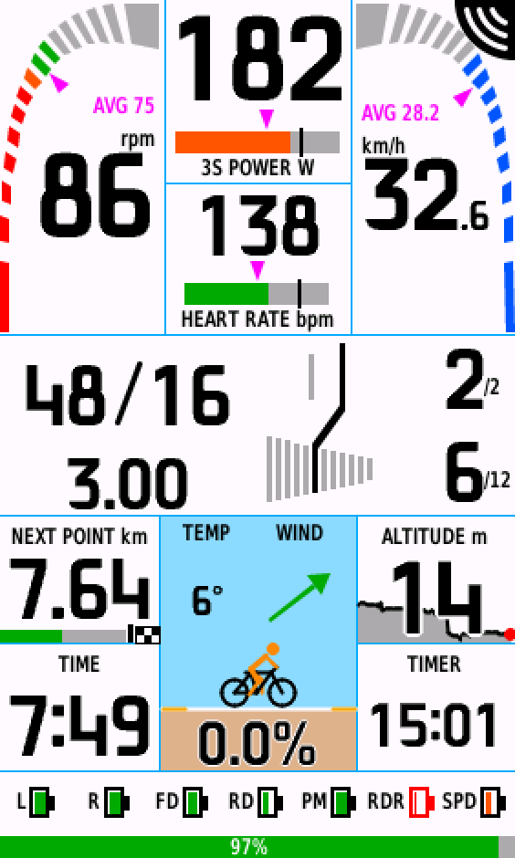

# Lazy Dashboard

[Connect IQ ストア](https://apps.garmin.com/apps/6b6fd786-e6ac-4419-9f56-75a55b97b7a3) · [English manual](README.md) · [한국어 설명서](README.ko.md)



このリポジトリには取扱説明書だけがあります。ご質問・不具合のご報告は開発者のメール [lazyfrmr@gmail.com](mailto:lazyfrmr@gmail.com) までお送りください（日本語で大丈夫です）。

Garmin Edge 用の Connect IQ データ項目です。ケイデンス・スピード・パワー・心拍、ドライブトレイン（ギアとクロスチェーン
の案内）、風・勾配・高度、コースナビゲーション、各パーツのバッテリーを 1 つの画面にまとめて表示します。SRAM AXS で
検証しています。Shimano Di2 はギア表示に対応しています（Di2 のバッテリーは Garmin がアプリに値を渡さないため表示できません）。

> **画面の表示言語について：** アプリの画面は英語と韓国語に対応しています。デバイスの言語が日本語の場合は英語で表示されます
> （この説明書では画面の表示を英語のまま `TEMP` のように書きます）。日本語表示は今後対応予定です。
>
> メニュー名は Garmin の日本語操作マニュアル（Edge 1040：2025 年 4 月版、Edge 530）に合わせています。機種やソフトウェアの
> バージョンによって少し異なる場合があります。

---

## 1. 対応機種

| 機種 | 画面 | Lazy Digits（大きな数字フォント） |
|---|---|---|
| Edge 1040 / 1050 | フルレイアウト | あり |
| Edge 550 / 850 | フルレイアウト | あり |
| Edge 1030 / 1030 Plus / 1030 Bontrager | フルレイアウト | なし（システムの数字フォント） |
| Edge 540 / 840 | コンパクト（数字中心） | あり |
| Edge 530 / 830 | コンパクト（数字中心） | なし（システムの数字フォント） |
| Edge 520 Plus | コンパクト（数字中心） | なし（システムの数字フォント） |

- **Lazy Digits** はアプリに内蔵した数字フォントです。540/840、550/850、1040、1050 はデバイスの言語を日本語（中国語・韓国語・
  タイ語も同じ）にすると、Connect IQ アプリが使える数字フォントが小さな固定サイズに切り替わります。Lazy Digits を使うので、
  言語に関係なく数字が大きく表示されます。ほかの機種はどの言語でも数字の大きさが変わらないため、システムのフォントを使います。
  フォントはオープンライセンス（OFL）で公開しています：https://github.com/bwchae/lazy-digits
- Edge 520 Plus は変速機の情報をアプリに渡さないため、変速機のバッテリーは表示できません（ギアは表示）。初代 Edge 520、
  Edge 1000 には対応していません。
- 必要なソフトウェア：Edge 1040 は **31.35 以降**、1050・850・550 は **32.20 以降**。インストール時にソフトウェアの更新を
  求められたら、Garmin Express またはデバイスのシステム設定で更新してからインストールしてください。

## 2. インストールとアップデート

1. スマートフォンに Garmin の **Connect IQ** アプリをインストールし、Edge と接続します。
2. Connect IQ アプリで **Lazy Dashboard** を検索してインストールします。
   ストア：https://apps.garmin.com/apps/6b6fd786-e6ac-4419-9f56-75a55b97b7a3
3. Edge がスマートフォンと同期するとアプリが転送されます。3 章の手順でトレーニングページに追加してください。

アップデートは Edge がスマートフォンと同期したときに届きます（Connect IQ アプリで自動アップデートをオフにしている場合は、
アプリから手動で更新してください）。設定はアップデート後もそのまま残ります。

## 3. トレーニングページに追加する

**Edge 1040（ほかのタッチパネル機種も同様）**
1. ホーム画面からメニュー ＞ [ライドプロフィール] をタップし、プロフィールを選びます。
2. [トレーニングページ] ＞ [追加] ＞ [トレーニングページ] の順にタップします。
3. データ項目のカテゴリーから **Connect IQ ＞ Lazy Dashboard** を選びます。
4. ページ分割のパターンは **1 分割**（データ項目 1 つ）を選び、チェックをタップして完了します。

**Edge 530 / 830**
1. ホーム画面から [メニュー] ＞ [設定] ＞ [アクティビティプロフィール] を選び、プロフィールを選びます。
2. [トレーニングページ] ＞ [新規追加] ＞ [トレーニングページ] を選びます。
3. データ項目のカテゴリーから **Connect IQ ＞ Lazy Dashboard** を選び、[完了] を選びます。

> 必ず **1 分割**のページに入れてください。複数の項目があるページに入れると、シンプルな小さいレイアウトで表示されます。

> **いつも使っているトレーニングページも 1 つ残しておいてください。** Connect IQ のデータ項目でエラーが起きた場合、Edge は
> 記録を続けますが、そのデータ項目はライドが終わるまで止まったままになります。隣にいつものページがあれば、スワイプして
> そのまま走り続けられます。

## 4. 最初に一度だけ行うこと

- **センサーのペアリング** — 電動シフター（AXS / Di2）、パワー計、心拍計を Edge の **センサー** に登録しておく必要があります。
  Edge 1040：メニュー ＞ [センサー] ＞ [センサー追加]。
- **歯数の入力** — Edge のセンサー一覧で電動シフターを選び、ギアの設定にチェーンリングとカセットの歯数を入力します（項目名は
  機種によって異なります）。入力しないと Edge の初期値が使われ、`46/15` などの歯数やギア比が正しく表示されません（ギア番号と
  クロスチェーンの判定は正確です）。SRAM AXS の D1 世代は AXS アプリに入力欄がないので、Edge で直接入力してください。
  Di2 は E-Tube で設定した歯数を使えます。
- **最初のライド** — 各ギアを一度ずつ使うと歯数を学習し（自転車ごとに保存）、ギアの図と変速の案内が正確になります。
- **スマートフォン** — 風の表示には、スマートフォンの Garmin Connect アプリが Edge に送る天気情報を使います。スマートフォンが
  つながっていないと風の欄に **No phone** と表示されます。ライド中につながっていたスマートフォンが切れると赤い **No phone!**
  に変わり、5 分以上休んでから走り出したときにスマートフォンが 20 秒以上切れていると、**全画面の警告と警告音**が一度だけ
  出ます（休憩した場所に置き忘れたときのため）。画面をタップするか戻るボタンで閉じます。

## 5. 設定

[ライドプロフィール]（530/830 は [アクティビティプロフィール]）＞ [トレーニングページ] ＞（Lazy Dashboard のページ）＞
Connect IQ データ項目の設定 ＞ **Lazy Dashboard**。項目を選ぶと値の一覧が開き、選ぶと保存されます。
スマートフォンの Connect IQ アプリからも設定できます。

| 設定（画面の表示） | 初期値 | 内容 |
|---|---|---|
| Language | Auto | Auto（デバイスの言語。日本語のデバイスでは英語）/ English / Korean |
| Power cell / Balance cell / Heart rate cell | Auto | その欄に表示する項目。Auto はセンサーに合わせて自動で選びます（下記）。**NP**（ノーマライズドパワー）も選べます：走り出して 30 秒後から表示。ライド中にデータ項目を再起動すると最初から計算し直します |
| Distance cell | Auto | 下段左の距離の欄。コースがないときは走行距離。コースナビゲーション中の **Auto** は、走っている間は次のコースポイント（名前と距離。コースポイントがなければゴールまでの距離）、止まると（信号待ち・休憩）ゴールまでの残り距離。**Ridden distance / To destination / Next course point** に固定することもできます。コースを外れると（30 m 以上が 5 秒）、走行距離に固定していない限りオレンジ色の `OFF COURSE` とコースまでの距離に変わります。コースナビゲーション中は欄の下に進捗バー（走った分は緑、次のコースポイントは白い縁の黒い柱、ゴールはチェッカーフラッグ）。次のコースポイントが 1 km 以内なら m で表示します（数字の後に小さな m：「350m」。コースまでの距離、上の欄の次のコースポイントも同じ）。上の 3 つの欄（パワー・バランス・心拍の欄）でも走行距離・次のコースポイントを選べます |
| FTP | 200 W | **ご自分の FTP に変えてください。** パワーの色（ゾーン）と閾値の目盛りの基準。スマートフォンでは 50〜600 W の任意の値、Edge のメニューでは現在の値 ±75 W を 5 W 刻みで選びます（一覧の端で開き直すとさらに先へ） |
| Cadence red below | 65 rpm | これより低いと赤。ギアを軽くする案内の基準 |
| Cadence green from / to | 70 / 95 rpm | 目標ケイデンスの範囲 |
| Speed dial max | 60 km/h | スピードの円弧の目盛りの最大値 |
| Cross-chain warning / cogs | On / 2 | アウター＋大きいコグ 2 枚、インナー＋小さいコグ 2 枚をクロスチェーンとみなします |
| Shift hint after | 3 s | クロスチェーンがこの時間続くと緑の案内 |
| Cross-chain pop-up | after 10 s | 長く続くとポップアップ。0 ＝ オフ |
| Easier-gear hint | On | ケイデンスのコーチング（下記） |
| BLE battery scan | On | AXS のバッテリー % を読み取ります。オフにするとバッテリーの節約になります |
| Batteries | All sensors | `Drivetrain + PM` にするとシフター・ディレイラー・パワー計だけを表示し、レーダー・スピード・ケイデンスセンサーは隠します（アイコンが大きくなります）。FIT の記録は変わりません |

**Auto の欄の決まり**
上段の性能エリア（1・2 段目）は、つながっているセンサーに合わせて自動で組み立てられます（パワーと心拍の欄が両方 Auto のとき）。
- 左（円弧）：ケイデンス → なければ 3 秒パワー → なければ心拍 → なければスピードだけを大きく。
- 中央：左に入らなかったパワー・心拍。1 つだけならその下に獲得標高（`ASCENT`）、どちらもなければ平均スピード（ケイデンスが
  あれば平均ケイデンスも）と獲得標高。
- 走り出してから 90 秒間は前回のセンサー構成で表示するので、センサーがつながる間に画面が切り替わりません。
- 一度つかんだパワー・ケイデンスはライドが終わるまで場所を保ちます（下り坂で 0 W でも）。心拍は 1 分以上値がないと
  （心拍計を外す、腕時計の心拍転送をオフにする）消え、Edge に再接続されると戻ります。
- バランスの欄：高度。（勾配はすべての機種で下段の姿勢計に表示されます。）

## 6. 画面の見方

### フルレイアウト（1040・1030・1050・550・850）
```
 ケイデンス円弧 | 3S POWER W  ###o  | スピード円弧
     88 rpm     | HEART RATE  #o#   |  32.5 km/h
 ---------------------------------------------
 46/15  2/2   スプロケットの図 + 矢印
 3.07   7/12
 ---------------------------------------------
 距離＋進捗     | 姿勢計（勾配）＋風 | 高度＋グラフ
 時刻           |                    | タイマー
 ---------------------------------------------
 L R FD RD PM バッテリー   （最下段：Edge 本体のバッテリー %）
```
- **ケイデンス・スピードの円弧** — 外側から内側へ満ちていきます。ケイデンスの色：赤（低い）/ オレンジ / 緑（目標）。
  円弧の内側の紫の三角 ＝ ライドの平均（単位の上の小さな紫の数字「AVG 29.9」でも表示）。
  **止まると**（信号待ち、休憩、タイマー一時停止）ケイデンス・スピード・パワーの大きな数字が平均値に変わり、単位に `AVG` が
  付きます。パワーのラベルにはここまでの NP も表示されます（「AVG W | NP 163」）。心拍は回復具合を見られるよう現在値のままです。
  平均スピードの欄（パワー・心拍センサーがないときなど）はスピードの円弧と重なるので、止まっている間は **停止時間**
  （`STOPPED`）を表示します。長い休憩を避ける目安にどうぞ。
- **3 秒パワー・心拍** — 大きな数字の下のバーの色が現在のゾーン（青・緑・オレンジ・赤・紫）、縦の目盛り ＝ FTP（心拍は閾値）、
  バーの上の紫の三角 ＝ 平均。
- **姿勢計** — 上り坂では地面が右に上がります（実際の角度の 3 倍に誇張）。下の数字が勾配 % で、地面の広い側へ少しずつ寄ります。
  両端の黄色い水平の目盛りは、地面に埋もれない側だけ見えます（ほぼ平坦なら両側）。
- **気温・風** — 空の左の `TEMP` は Edge の温度センサーの値（Edge 標準の気温のデータ項目と同じセンサー。なければスマートフォンの
  天気）、右の `WIND` は進行方向を基準にした矢印です。日なたで止まっていると、センサーが実際より高めに出ることがあります。
- **ライダー（オレンジ）** — ペダルを漕いでいる間は両足が 1 秒ごとに入れ替わります。止まると左足を地面に下ろし、5 分以上止まる
  と（信号待ちより長い）自転車を降りて椅子に脚を組んで座ります。
- **風** — 上が進行方向。ライダーの上の矢印が風の吹いていく方向で、風が強いほど太くなります。赤 向かい風 / オレンジ 横風 /
  緑 追い風。風速の数字は表示しません。Garmin の天気は近くの観測所 1 か所の平均風速を 1 時間に 1 回ほど受け取る値で、突風が
  含まれず実際より弱く出るためです。1.5 m/s 未満（ごく弱い風）は **円の中の小さな矢じり**（青緑）で表示します。
  風はスマートフォンが受け取った天気の値なので、数十分〜1 時間に 1 回ほどしか変わりません（実際の突風を測るものではありません）。

### コンパクトレイアウト（530・830・540・840）
上段は数字中心（ケイデンス | スピード、パワー | 心拍、ドライブトレイン）、下段はフルレイアウトと同じ環境パネル（距離 / 時刻 |
姿勢計＋風 | 高度 / タイマー）です。時刻が左にあるのは、右端に出るレーダーのバーに分の数字が隠れないようにするためです。
姿勢計はモノトーン（地面だけグレー）で数字が見やすく、風の矢印だけ色が付きます。ケイデンスの数字は範囲の色（赤・オレンジ・緑）です。

### ドライブトレイン（全機種）
- **46/15** — 現在のチェーンリング / コグの歯数。**3.07** — ギア比（クランク 1 回転で後輪が約 3 回転）。
- **2/2, 7/12** — フロント何段目 / リア何段目（リアは一番大きいコグが 1 段目）。
- **緑の矢印 ＋ `Shift to Green`** — クロスチェーンです。緑で示したギアに変えてください。
- **オレンジの矢印 ＋ `Shift easier`** — 上り坂（勾配 2 % 以上）や強い向かい風の中で、ケイデンスが赤の基準より低い状態が
  8 秒以上続きました。ギアを 1 段軽くしてください。変速するとまた 8 秒数え直します。パワー計がある場合は力を出しているとき
  （FTP の 60 % 以上）だけ、向かい風は 2 分以上止まらずに走っているときだけ案内します。平坦な市街地や発進・信号待ちでは出ません。

### 機械式変速機
電動変速機（AXS・Di2）の情報がないと、ドライブトレインの欄が変わります。
- ケイデンスがある場合（ケイデンスセンサーまたはパワー計）：左に **推定ギア比**（`RATIO ~`、スピードとケイデンスから計算、
  700c の車輪で近似）と **クランク 1 回転で進む距離**（`m / crank`）。右に目標ケイデンスの範囲、ケイデンスの低い状態が 8 秒
  続くと **オレンジの矢印 ＋ `Shift easier`**。
- ケイデンスがない場合：最高速度（`MAX SPEED`）| カロリー。

### バッテリー
- パーツ：**L・R** 左右のシフター、**FD・RD** フロント・リアディレイラー、**PM** パワー計、**RDR** レーダー（ライト一体型を含む）、
  **SPD** スピードセンサー、**CAD** ケイデンスセンサー。
- 設定は不要：Edge にペアリングされ、**いま接続しているセンサーだけ**欄が出ます。
- 欄が足りないときは、状態の良いパーツは右端の **`OK 6`**（反転色の枠、数字 ＝ 個数）にまとめられ、確認が必要なパーツだけ
  個別に表示されます。
- グレーの **`?`**：このライドで（または 10 分以内に終わった前回のライドで）つながっていたセンサーがいま見えない状態 —
  電源が切れたか、電池が切れた可能性があります。
- 色：緑 良好 / オレンジ 普通 / 赤 交換。走っている間はアイコン、止まると電圧・% の数字に変わります。
- 読み取れないもの：心拍計、Bluetooth だけでつながるセンサー、Di2 — Edge のセンサー画面で確認してください。
- 最下段のバー：**Edge 本体のバッテリー** %。30 % 以上は緑、15 % 以上はオレンジ、それ未満は赤。
- Di2：`Di2 batt: Edge sensor page` と表示されます。Di2 のバッテリーは Garmin 純正のセンサー画面で確認してください。

## 7. 困ったときは

| 症状 | 確認すること |
|---|---|
| インストールできない / ソフトウェア更新の案内が出る | Edge のソフトウェアのバージョン（1 章）。更新してからもう一度インストール |
| Connect IQ の一覧に出てこない | スマートフォンと同期したか（Connect IQ アプリでインストール待ちになっていないか） |
| 小さいレイアウトで表示される | 1 分割のページに入れたか |
| ギアが出ない | 電動変速機ならシフトセンサーのペアリング。機械式は「機械式変速機」を参照 |
| 歯数・ギア比がおかしい | Edge のセンサー設定で歯数を入力。直した後、各ギアを一度ずつ使う |
| 風が `--` | スマートフォンの接続、5 km/h 以上で走っているか（進行方向が必要） |
| 次のコースポイントに道路名が出る | コースの転換点案内（[コースナビゲーション]）がオンだと、曲がり角が「次の地点」になります。コースポイントだけを見たいときはオフにしてください |
| コースポイントの名前が途中で切れる | Garmin Connect は名前を 16 バイト（日本語で 5 文字程度）までしか保存しません。短い名前にしてください |
| 汗や雨でデータ項目が別の項目に変わる | タッチパネルが長押しと判断したものです。汗をかく日や雨の日は **画面のロック** を使ってください（タッチパネル機種：アクティビティ中に電源ボタンを押すとロック / 解除）。変わった項目はトレーニングページの編集で Lazy Dashboard に戻します |
| ライド中に IQ のロゴだけになる | アプリがエラーで止まった状態です。記録は続いているので、いつものページにスワイプして走り続けてください。下の「ライド中に再起動する」で、アクティビティを終えずに再起動できます。`Garmin\Apps\LOGS\` の `CIQ_LOG` ファイル（`.YML` または `.BAK`）を開発者に送ってください |
| 画面が空白・青一色になる | 開発者に知らせてください（機種と画面の写真） |

### ライド中に再起動する
エラーで IQ のロゴだけが残ったとき、記録を止めずに Lazy Dashboard を再起動できます。トレーニングページの編集メニューに入り、
**何も変えずに**戻るだけです。

| 機種 | 手順 |
|---|---|
| Edge 1040、840、540、550、850、1050 | メニュー ＞ [ライドプロフィール] ＞（現在のプロフィール）＞ [トレーニングページ] ＞（Lazy Dashboard のページ）＞ [分割数とデータ項目] |
| Edge 530、830 | [メニュー] ＞ [設定] ＞ [アクティビティプロフィール] ＞（現在のプロフィール）＞ [トレーニングページ] ＞（Lazy Dashboard のページ）＞ [分割数とデータ項目] |

- タッチパネル機種は画面をタップしてメニューを開き、分割数の画面が出たら **戻る** を何回か押してライド画面に戻ります。
- ボタン機種（530、540 など）はボタンでメニューを開いて同じ手順で入り、戻るボタンで出ます。分割数の画面で上 / 下ボタンを押すと
  レイアウトが変わるので、その画面では戻るだけを押してください。
- Edge 1040 で確認した方法です。ほかの機種も同じ仕組み（トレーニングページを読み込み直す）で動くと考えています。
- 再起動すると、Edge が計算する値（距離、平均、獲得標高）はそのまま続き、Lazy Dashboard が自分で集める値（走行軌跡の図、
  センサーの記録）はその時点から新しく始まります。
