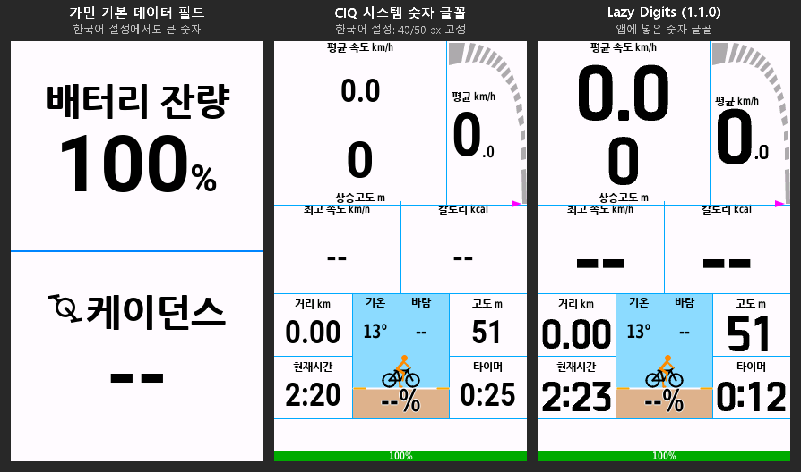
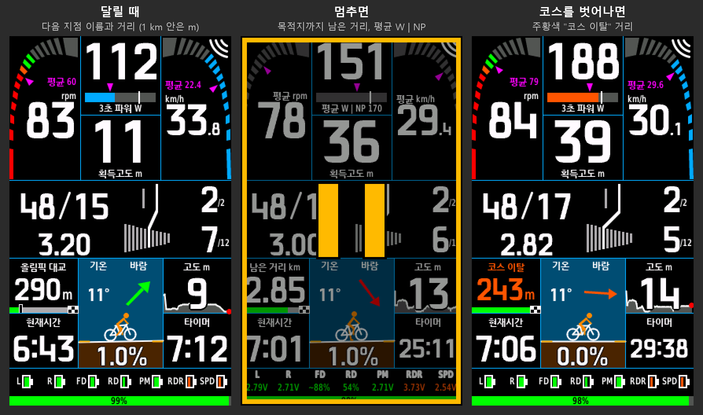

# Lazy Dashboard

[Connect IQ 스토어](https://apps.garmin.com/apps/6b6fd786-e6ac-4419-9f56-75a55b97b7a3) · [English manual](README.md) · [日本語マニュアル](README.ja.md)





이 저장소에는 사용 설명서만 있습니다. 질문·문제 제보는 [도싸 소개글](https://corearoadbike.com/board/board.php?t_id=Menu03Top1&no=2628419) 댓글이나 개발자 이메일 [lazyfrmr@gmail.com](mailto:lazyfrmr@gmail.com)로 보내 주세요.

Garmin Edge용 Connect IQ 데이터 필드입니다. 화면 하나에 케이던스·속도·파워·심박, 변속(기어·크로스체인 안내),
바람·경사·고도, 부품 배터리를 모아 보여줍니다. SRAM AXS에서 검증했고, Shimano Di2는 기어 표시를 지원합니다
(Di2 배터리는 Garmin이 앱에 값을 주지 않아 표시할 수 없습니다).

> 메뉴 이름은 Garmin 공식 한국어 사용 설명서(Edge 530, Edge 1040) 기준입니다. 기기·펌웨어에 따라 조금 다를 수 있습니다.

---

## 1. 지원 기기

| 기기 | 화면 | Lazy Digits(큰 숫자 글꼴) |
|---|---|---|
| Edge 1040 / 1050 | 큰 화면 배치 | 있음 |
| Edge 550 / 850 | 큰 화면 배치 | 있음 |
| Edge 1030 / 1030 Plus / 1030 Bontrager | 큰 화면 배치 | 없음(시스템 숫자 글꼴) |
| Edge 540 / 840 | 작은 화면(숫자) 배치 | 있음 |
| Edge 530 / 830 | 작은 화면(숫자) 배치 | 없음(시스템 숫자 글꼴) |
| Edge 520 Plus | 작은 화면(숫자) 배치 | 없음(시스템 숫자 글꼴) |

- **Lazy Digits**는 앱에 넣은 숫자 글꼴입니다. 본체를 한국어로 설정하면 Connect IQ 앱이 쓰는 숫자 글꼴이 작은 고정
  크기로 바뀌는 기기(540/840, 550/850, 1040, 1050)에 들어가, 언어와 관계없이 숫자가 큼직하게 나옵니다. 나머지 기기는
  한국어에서도 숫자가 작아지지 않아 시스템 글꼴을 씁니다. 글꼴은 공개(OFL): https://github.com/bwchae/lazy-digits
- Edge 520 Plus는 앱에 변속기 정보를 주지 않아 변속기 배터리를 표시할 수 없습니다(기어는 표시). 원조 Edge 520, Edge 1000은 지원하지 않습니다.
- 필요한 소프트웨어: Edge 1040은 **31.35 이상**, 1050·850·550은 **32.20 이상**. 설치할 때 소프트웨어 업데이트가 필요하다고
  나오면 Garmin Express나 Edge 설정에서 업데이트한 뒤 설치하세요.

## 2. 설치·업데이트

1. 휴대폰에 **Connect IQ** 앱(Garmin)을 설치하고 Edge와 연결합니다.
2. Connect IQ 앱에서 **Lazy Dashboard**를 검색해 설치합니다.
   스토어: https://apps.garmin.com/apps/6b6fd786-e6ac-4419-9f56-75a55b97b7a3
3. Edge가 휴대폰과 동기화되면 앱이 들어옵니다. 아래 3장처럼 데이터 화면에 추가합니다.

업데이트는 Edge가 휴대폰과 동기화될 때 들어옵니다(Connect IQ 앱에서 자동 업데이트를 꺼 두었다면 앱에서 직접 업데이트).
설정은 업데이트 후에도 그대로 남습니다.

## 3. 데이터 화면에 추가

**Edge 530 / 830**
1. **메뉴 > 설정 > 액티비티 프로파일**을 선택하고 프로필(예: 로드)을 고릅니다.
2. **데이터 화면 > 신규 추가 > 데이터 화면**을 선택합니다.
3. 화살표로 **필드 1개짜리 레이아웃**을 고릅니다.
4. 데이터 필드 카테고리에서 **Connect IQ > Lazy Dashboard**를 고르고 **완료**를 선택합니다.

**Edge 1040 (및 그 밖의 터치 기기)**
1. 메뉴 아이콘 > **활동 프로필**을 선택하고 프로필을 고릅니다.
2. **데이터 화면 > 신규 추가 > 데이터 화면**을 선택합니다.
3. 화살표로 **필드 1개짜리 레이아웃**을 고르고, 필드를 **Connect IQ > Lazy Dashboard**로 지정합니다.

> 꼭 **필드 1개짜리** 화면에 넣으세요. 칸이 여러 개인 화면에 넣으면 간단한 작은 배치로 나옵니다.

> **평소 쓰던 데이터 화면도 하나 남겨 두세요.** Connect IQ 필드에 오류가 나면 Edge는 기록을 계속하지만, 그 필드는
> 라이딩이 끝날 때까지 꺼진 채로 있습니다. 옆에 평소 화면이 있으면 넘기고 그대로 달리면 됩니다.

## 4. 처음 한 번 해 둘 것

- **센서 페어링** — 변속기(AXS/Di2)·파워미터·심박계가 가민 **센서** 목록에 연결돼 있어야 값이 나옵니다.
  Edge 1040: 메뉴 > **센서 > 센서 추가**.
- **톱니수 입력** — 가민의 변속기 센서 설정(기어 정보)에 체인링·카세트 톱니수를 입력합니다.
  입력하지 않으면 가민 기본값이 쓰여 `46/15` 같은 톱니 표시와 기어비가 틀립니다(단 번호와 크로스체인 판정은 정확).
  SRAM D1 세대는 AXS 앱에 입력란이 없어 가민에 직접 입력해야 합니다. Di2는 E-Tube에 입력한 값을 쓸 수 있습니다.
- **첫 주행** — 각 기어를 한 번씩 쓰면 톱니가 학습되어 그림과 변속 안내가 정확해집니다(자전거별로 저장).
- **폰 연결** — 바람 표시는 폰의 Garmin Connect가 받아 둔 날씨를 씁니다. 폰이 연결되지 않으면 바람 칸에 **폰 없음**이 나옵니다.
  라이딩 중 연결돼 있던 폰이 끊기면 빨간 **폰 없음!** 상자로 바뀌고, 5분 넘게 쉬었다가 다시 출발했는데 폰이 20초 넘게
  끊겨 있으면 **전체 화면 경고와 경고음**이 한 번 나옵니다(쉬던 곳에 두고 왔을 때). 화면을 누르거나 뒤로 가기로 닫습니다.

## 5. 설정 바꾸기

**액티비티 프로파일(활동 프로필) > 데이터 화면 > (Lazy Dashboard가 있는 화면) > Connect IQ 데이터 필드**
(영문 메뉴: *Connect IQ Data Fields*) > **Lazy Dashboard**. 항목을 누르면 값 목록이 열리고, 고르면 저장됩니다.

| 설정 | 기본값 | 설명 |
|---|---|---|
| 언어 | 자동 | 자동(기기 언어) / English / 한국어 |
| 파워 칸 / 밸런스 칸 / 심박 칸 | 자동 | 칸에 보일 항목. 자동이면 센서에 맞춰 고름(아래 참고). **NP**(노멀라이즈드 파워)도 고를 수 있음: 출발 30초 뒤부터 표시, 주행 중 필드를 다시 켜면 처음부터 다시 계산 |
| 거리 칸 | 자동 | 아래 패널 왼쪽 거리 칸. 코스가 없으면 늘 주행 거리. 코스 안내 중 **자동**은 달릴 때 다음 코스포인트(이름과 거리, 코스포인트가 없으면 남은 거리), 멈추면(신호 대기·휴식) 목적지까지 남은 거리. **주행 거리 / 남은 거리 / 다음 코스포인트**로 고정할 수도 있음. 코스를 벗어나면(30 m 넘게 5초) 주행 거리 고정이 아닌 한 주황색 "코스 이탈" 거리로 바뀜. 코스 안내 중에는 칸 아래에 진행 막대(지나온 몫은 초록, 다음 코스포인트는 흰 테두리 검은 기둥, 끝은 체크무늬 결승선). 다음 코스포인트가 1 km 안이면 m로 표시(숫자 뒤에 작은 m: "350m". 코스 이탈 거리, 위 칸의 다음 코스포인트도 같음). 위 칸 셋(파워·밸런스·심박 칸)에도 주행 거리·다음 코스포인트를 고를 수 있어 섞어 쓸 수 있음 |
| FTP | 200 W | **자기 FTP로 바꾸세요.** 파워 색(존)과 역치 눈금 기준. 폰에서는 50~600 W 아무 값, Edge 메뉴에서는 지금 값 ±75 W를 5 W 단위로 고름(목록 끝에서 다시 열면 더 멀리) |
| 케이던스 빨강 기준 | 65 rpm | 이보다 낮으면 빨강, 가벼운 기어 안내 기준 |
| 케이던스 초록 시작 / 끝 | 70 / 95 rpm | 목표 케이던스 구간 |
| 속도계 최대 | 60 km/h | 속도 원호 눈금 끝 |
| 크로스체인 경고 / 코그 수 | 켜기 / 2 | 큰 링+큰 코그 2개, 작은 링+작은 코그 2개를 크로스체인으로 봄 |
| 변속 안내 시점 | 3초 | 크로스체인이 이 시간 지속되면 녹색 안내 |
| 크로스체인 팝업 | 10초 후 | 오래 지속되면 팝업. 0 = 끄기 |
| 가벼운 기어 안내 | 켜기 | 케이던스 코칭(아래 참고) |
| 블루투스 배터리 스캔 | 켜기 | AXS 배터리 % 읽기. 끄면 배터리 절약 |
| 배터리 표시 | 전체 센서 | "구동계·파워미터만"이면 레버·디레일러·파워미터만 보여 주고 레이더·속도·케이던스 센서는 숨김(아이콘이 커짐). FIT 기록은 그대로 |

**자동 칸 규칙**
위쪽 성능 칸(1·2단)은 연결된 센서에 맞춰 스스로 구성됩니다(파워 칸·심박 칸이 둘 다 자동일 때).
- 왼쪽(원호): 케이던스 → 없으면 3초 파워 → 없으면 심박 → 없으면 속도만 크게.
- 가운데: 왼쪽에 안 들어간 파워·심박. 하나뿐이면 그 아래에 획득고도, 둘 다 없으면 평균 속도(케이던스가 있으면 평균 rpm도)와 획득고도.
- 출발 후 90초 동안은 지난번 센서 구성으로 보여 줘서, 센서가 연결되는 사이 화면이 바뀌지 않습니다.
- 한 번 잡힌 파워·케이던스는 라이딩이 끝날 때까지 자리를 지킵니다(내리막에서 0이어도). 심박은 1분 넘게 값이 없으면
  (심박계를 빼거나 워치 심박 송출을 끔) 빠지고, Edge에 다시 연결되면 돌아옵니다.
- 밸런스 칸: 고도. (경사도는 모든 기기에서 아래 자세계에 나옵니다.)

## 6. 화면 읽는 법

### 큰 화면 (1040·1030·1050·550·850)
```
 케이던스 원호 | 3초 파워 W  ▓▓▓○  | 속도 원호
     88 rpm    | 심박 bpm   ▓○▓  |  32.5 km/h
 ---------------------------------------------
 46/15  2/2   스프라켓 그림 + 화살표
 3.07   7/12
 ---------------------------------------------
 거리+경로 | 자세계(경사) + 바람 | 고도+그래프
 시각      |                     | 타이머
 ---------------------------------------------
 L R FD RD PM 배터리        (맨 아래: 가민 배터리 %)
```
- **케이던스·속도 원호** — 바깥에서 안쪽 위로 차오릅니다. 케이던스 색: 빨강(낮음) / 주황 / 초록(목표). 계기판 안쪽의 보라색 삼각형 = 라이딩 평균(단위 위에 보라색 작은 숫자로도 "평균 29.9").
  **멈추면**(신호 대기, 휴식, 일시정지) 케이던스·속도·파워의 큰 숫자가 평균값으로 바뀌고 단위 앞에 "평균"이 붙습니다. 파워 이름표에는 지금까지의 NP도 함께 나옵니다("평균 W | NP 163").
  평균 속도 칸(파워·심박 센서가 없을 때 등)은 속도 계기판과 겹치므로 멈춘 동안 **정차 시간**을 보여 줍니다(긴 정차를 피하는 데 참고).
  심박은 회복 정도를 보도록 지금 값 그대로입니다.
- **3초 파워·심박** — 큰 숫자 아래 막대 색이 지금 존(파랑·초록·주황·빨강·보라), 세로 눈금 = FTP(심박은 역치), 막대 위 보라색 삼각형 = 평균.
- **자세계** — 오르막이면 땅이 오른쪽으로 솟습니다(실제 각도의 3배로 과장). 아래 숫자가 경사도 %이고, 땅이 넓은 쪽으로
  조금씩 옮겨 갑니다. 양 끝 노란 수평 기준선은 땅에 묻히지 않는 쪽만 보입니다(거의 평지면 양쪽).
- **기온 · 바람** — 하늘 왼쪽 "기온"은 Edge 온도 센서 값(가민 기본 온도 필드와 같은 센서, 없으면 휴대폰 날씨),
  오른쪽 "바람"은 진행 방향 기준 화살표입니다. 햇볕 아래 정차하면 센서가 실제보다 높게 나올 수 있습니다.
- **라이더(주황)** — 페달을 밟는 동안 두 발이 1초마다 번갈아 움직입니다. 멈추면 왼발을 땅에 내리고,
  5분 넘게 멈춰 있으면 자전거에서 내려 의자에 다리를 꼬고 앉아 쉽니다(신호 대기는 해당 없음).
- **바람** — 위가 진행 방향. 라이더 위 하늘의 화살표가 바람이 가는 방향이고, 바람이 셀수록 굵어집니다.
  빨강 맞바람 / 주황 옆바람 / 초록 뒷바람. 풍속 숫자는 표시하지 않습니다 — Garmin 날씨는 가까운 관측소 한 곳의 평균 풍속을
  한 시간에 한 번쯤 받는 값이라 돌풍이 빠지고 실제보다 약하게 나오기 때문입니다. 1.5 m/s 미만(실바람)은 **동그라미 안의 작은 화살촉**(청록색)으로 나옵니다.
  바람은 폰이 받아 둔 날씨 값이라 보통 수십 분~1시간에 한 번 바뀝니다(실제 돌풍을 재는 것이 아님).

### 작은 화면 (530·830·540·840)
위쪽은 숫자 위주(케이던스 | 속도, 파워 | 심박, 구동계), 아래쪽은 큰 화면과 같은 환경 패널(거리 / 시각 | 자세계+바람 |
고도 / 타이머)입니다. 시각이 왼쪽인 것은 오른쪽 가장자리에 뜨는 레이더 표시줄에 분 단위가 가리지 않게 하기 위해서입니다. 자세계는 무채색(땅만 회색)이라 숫자가 잘 보이고, 바람 화살표만 색이 있습니다.
케이던스 숫자 색이 구간 색(빨강·주황·초록)입니다.

### 구동계 (모든 기기)
- **46/15** — 지금 체인링/코그 톱니수. **3.07** — 기어비(크랭크 1바퀴에 뒷바퀴 약 3바퀴).
- **2/2, 7/12** — 앞 몇 단 / 뒤 몇 단(뒤는 가장 큰 코그가 1단).
- **녹색 화살표 + `녹색으로 변속`(Shift to Green)** — 크로스체인입니다. 녹색으로 표시된 기어로 바꾸세요.
- **주황 화살표 + `가볍게 변속`(Shift easier)** — 오르막(경사 2 % 이상)이나 강한 맞바람 속에서 케이던스가 빨강 기준 아래로
  8초 이상 이어졌습니다. 한 단 가볍게 바꾸세요. 변속하면 다시 8초를 셉니다. 파워미터가 있으면 힘을 쓸 때(FTP의 60 % 이상)만,
  맞바람은 2분 이상 멈추지 않고 달릴 때만 안내합니다. 평지 시내 주행, 출발·신호 대기에서는 나오지 않습니다.

### 수동 변속기
전자식 변속기(AXS·Di2) 정보가 없으면 구동계 칸이 바뀝니다.
- 케이던스가 있으면(케이던스 센서 또는 파워미터): 왼쪽에 **추정 기어비**(속도와 케이던스로 계산, 700c 바퀴 기준 근사)와
  **크랭크 한 바퀴에 가는 거리**. 오른쪽에 목표 케이던스 구간, 케이던스가 낮게 8초 이어지면 **주황 화살표 + 가볍게 변속**.
- 케이던스가 없으면: 최고 속도 | 칼로리.

### 배터리
- 부품: **L·R** 좌우 레버, **FD·RD** 앞·뒤 변속기, **PM** 파워미터, **레이더**(라이트 일체형 포함), **속도**·**케이던스** 센서.
- 설정할 것 없음: 가민에 페어링되어 **지금 연결된 센서만** 칸이 생깁니다.
- 칸이 모자라면 상태가 좋은 부품은 오른쪽 **`OK 6`**(반전 색 상자, 숫자 = 개수) 하나로 묶이고, 살펴볼 부품만 따로 보입니다.
- 회색 **`?`**: 이번 라이딩에서(또는 10분 안에 끝난 직전 라이딩에서) 연결됐던 센서가 지금 안 보이는 것 — 꺼졌거나 배터리가 다 됐을 수 있습니다.
- 색: 초록 양호 / 주황 보통 / 빨강 교체. 주행 중에는 아이콘, 멈추면 전압·% 숫자로 바뀝니다.
- 읽을 수 없는 것: 심박 스트랩, 블루투스로만 연결된 센서, Di2 — 가민 센서 화면에서 확인하세요.
- 맨 아래 막대: **가민 본체 배터리** %. 30 % 이상 초록, 15 % 이상 주황, 그 아래 빨강.
- Di2: `Di2 배터리: Edge 센서 화면` 안내가 나옵니다. Di2 배터리는 가민 순정 센서 화면에서 확인하세요.

## 7. 문제 해결

| 증상 | 확인할 것 |
|---|---|
| 설치가 안 됨 / 소프트웨어 업데이트 안내 | Edge 소프트웨어 버전(1장). 업데이트 후 다시 설치 |
| Connect IQ 목록에 없음 | 휴대폰과 동기화됐는지(Connect IQ 앱에 설치 대기로 남아 있지 않은지) |
| 다음 코스포인트에 도로 이름이 나옴 | Edge의 턴 안내가 켜져 있으면 회전 지점이 "다음 지점"이 됩니다. 코스포인트만 보려면 턴 안내를 끄세요 |
| 코스포인트 이름이 잘림 | Garmin Connect가 이름을 16바이트(한글 5자 정도)까지만 저장합니다. 짧게 지어 두세요 |
| 화면이 작은 배치로 나옴 | 필드 1개짜리 레이아웃에 넣었는지 |
| 기어가 안 나옴 | 전자식이면 변속기 센서 페어링. 수동 변속기는 아래 "수동 변속기" 참고 |
| 톱니수·기어비가 이상함 | 가민 센서 설정의 톱니수 입력. 고친 뒤 각 기어를 한 번씩 사용 |
| 바람이 `--` | 폰 연결, 속도가 5 km/h 이상인지(진행 방향 필요) |
| 땀이나 비로 필드가 다른 항목으로 바뀜 | 터치스크린이 길게 누름으로 받아들인 것입니다. 땀이 많이 나거나 비 오는 날은 **화면 잠금**을 쓰세요(터치 기기: 전원 버튼을 누르면 잠금·해제). 바뀐 칸은 데이터 화면 편집에서 Lazy Dashboard로 되돌립니다 |
| 주행 중 IQ 로고만 나옴 | 앱 오류로 꺼진 상태입니다. 기록은 그대로이니 평소 화면으로 넘겨 계속 달리세요. 아래 "주행 중 다시 켜기"로 활동을 끝내지 않고 다시 켤 수 있습니다. `Garmin\Apps\LOGS\`의 `CIQ_LOG` 파일(`.YML` 또는 `.BAK`)을 개발자에게 보내 주세요 |
| 화면이 비거나 파랗게 나옴 | 개발자에게 알려 주세요(기기·화면 상태 사진) |

### 주행 중 다시 켜기
오류로 IQ 로고만 남았을 때, 기록을 멈추지 않고 Lazy Dashboard를 다시 켤 수 있습니다. 데이터 화면 편집 메뉴에
들어갔다가 **아무것도 바꾸지 않고** 뒤로 나오면 됩니다. 메뉴 이름은 Garmin 한국어 사용 설명서의 "데이터 화면
편집하기" 기준입니다.

| 기기 | 경로 |
|---|---|
| Edge 1040, 840, 540 | 메뉴 아이콘 > **활동 프로필** > (지금 프로필) > **데이터 화면** > (Lazy Dashboard 화면) > **레이아웃 및 데이터 필드** |
| Edge 550, 850 | 메뉴 아이콘 > **활동 프로필** > (지금 프로필) > **데이터 화면** > (Lazy Dashboard 화면) > **레이아웃 및 데이터 항목** |
| Edge 530, 830 | **메뉴 > 설정 > 액티비티 프로파일** > (지금 프로필) > **데이터 화면** > (Lazy Dashboard 화면) > **레이아웃 및 데이터 필드** |

- 터치 기기는 화면을 탭해 메뉴를 열고, 레이아웃 화면이 나오면 **뒤로**를 몇 번 눌러 라이딩 화면으로 돌아옵니다.
- 버튼 기기(530, 540 등)는 버튼으로 메뉴를 열고 같은 경로로 들어갔다가 뒤로 버튼으로 나옵니다. 레이아웃 화면에서
  위/아래 버튼을 누르면 레이아웃이 바뀌니, 그 화면에서는 뒤로만 누르세요.
- Edge 1040에서 확인한 방법입니다. 다른 기기도 같은 원리(데이터 화면을 다시 불러옴)로 동작할 것으로 봅니다.
- 다시 켜지면 Edge가 계산하는 값(거리, 평균, 획득고도)은 이어지고, 대시보드가 직접 모으는 값(주행 궤적 그림,
  센서 기록)은 그 시점부터 새로 시작합니다.
