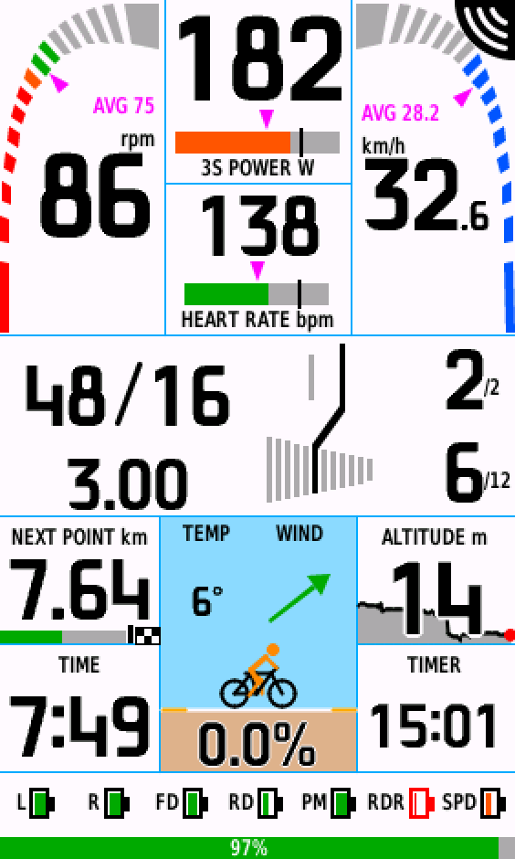

# Lazy Dashboard

[Connect IQ Store](https://apps.garmin.com/apps/6b6fd786-e6ac-4419-9f56-75a55b97b7a3) · [한국어 설명서](README.ko.md) · [日本語マニュアル](README.ja.md) · [繁體中文說明](README.zh-TW.md)

Bike with a mechanical groupset? **[Lazy Dashboard – Mechanical](mechanical/README.md)** shows the gear estimated from speed and cadence.



This repository holds the user manual only. Questions and bug reports: e-mail the developer at [lazyfrmr@gmail.com](mailto:lazyfrmr@gmail.com), or comment on the [introduction post](https://corearoadbike.com/board/board.php?t_id=Menu03Top1&no=2628419) (Korean cycling forum).

A Connect IQ data field for Garmin Edge. One screen shows cadence, speed, power and heart rate, your drivetrain (gears
and cross-chain guidance), wind, grade and altitude, and component batteries. Verified with SRAM AXS; Shimano Di2 gears
are supported (Di2 batteries can't be shown: Garmin doesn't give their values to apps).

> Menu names follow Garmin's English Edge owner's manuals. They may differ slightly by device and firmware.

---

## 1. Supported devices

| Device | Layout | Lazy Digits (big digit font) |
|---|---|---|
| Edge 1040 / 1050 / 1060 | full | yes |
| Edge 550 / 850 | full | yes |
| Edge 1030 / 1030 Plus / 1030 Bontrager | full | no (system digits) |
| Edge 540 / 840 | compact (numbers) | yes |
| Edge 530 / 830 | compact (numbers) | no (system digits) |
| Edge 520 Plus | compact (numbers) | no (system digits) |

- **Lazy Digits** is a digit font built into the app. Set to an Asian language (Korean, Japanese, Chinese, Thai), the
  540/840, 550/850, 1040, 1050 and 1060 give Connect IQ apps small fixed-size digit fonts; with Lazy Digits the numbers stay
  big in any language. The other devices keep the same digits in every language and use the system font. The font is
  open (OFL): https://github.com/bwchae/lazy-digits
- The Edge 520 Plus doesn't give apps shifting data, so shifter batteries can't be shown (gears are). The original
  Edge 520 and the Edge 1000 aren't supported.
- Required software: Edge 1040 **31.35 or later**, 1050 / 850 / 550 **32.20 or later**. If the install asks for a
  software update, update with Garmin Express or the Edge's settings, then install again.

## 2. Install and update

1. Install Garmin's **Connect IQ** app on your phone and connect it to the Edge.
2. Search for **Lazy Dashboard** in the Connect IQ app and install it.
   Store: https://apps.garmin.com/apps/6b6fd786-e6ac-4419-9f56-75a55b97b7a3
3. The app reaches the Edge at its next phone sync. Add it to a data screen as in section 3.

Updates arrive when the Edge syncs with the phone (if automatic updates are off in the Connect IQ app, update from
there). Your settings are kept.

**Updating to 1.3.0:** this version adds two permissions for the online wind, Background and Communications
(the store lists them as sending / receiving data over the internet). If the Connect IQ app asks you to allow
access, tap **Allow** and the update installs. The window may not name the permission (a known Connect IQ app
issue): it is this one. Only your position, rounded to about 5 km, goes to Open-Meteo every 10 minutes through the
phone; nothing that identifies you. The setting **Online wind** turns it off.

## 3. Add it to a data screen

**Edge 530 / 830**
1. Select **Menu > Settings > Activity Profiles** and pick a profile (e.g. Road).
2. Select **Data Screens > Add New > Data Screen**.
3. Use the arrows to choose the **one-field layout**.
4. In the data field categories select **Connect IQ > Lazy Dashboard**, then **Done**.

**Edge 1040 (and other touch units)**
1. Select the menu icon > **Activity Profiles** and pick a profile.
2. Select **Data Screens > Add New > Data Screen**.
3. Use the arrows to choose the **one-field layout** and set the field to **Connect IQ > Lazy Dashboard**.

> Use a **one-field** screen. On a screen with several fields you get the small, simple layout.

> **Keep one of your usual data screens.** If a Connect IQ field ever fails, the Edge keeps recording but the field
> stays off until the ride ends. With a regular screen next to it you just swipe and ride on.

## 4. One-time setup

- **Pair your sensors** — shifting (AXS/Di2), power meter and heart-rate strap must be in the Edge's **Sensors** list.
  Edge 1040: menu > **Sensors > Add Sensor**.
- **Enter your teeth** — in the Edge's shifting sensor settings (gear info), enter chainring and cassette teeth.
  Without them the Edge sends its defaults and the sprocket chart's sizes are off (the gear number and cross-chain
  detection are right either way). SRAM D1 has no field for this in the AXS app, so enter it on the Edge. Di2 can use the
  teeth set in E-Tube.
- **First ride** — use every gear once; the teeth are learned (per bike) and the chart and hints become exact.
- **Phone** — wind comes through your phone (Open-Meteo over its internet connection, or the weather Garmin Connect
  keeps on the Edge). Without a phone the wind area
  shows **No phone**. If the phone that was connected during the ride drops out, it turns into a red **No phone!** box,
  and riding off after a stop of more than 5 minutes with the phone gone for 20 s brings a **full-screen alert with a
  tone**, once (left at the café?). Tap the screen or press Back to close it; left alone, the Edge closes it after a
  while. The red **No phone!** stays until the phone connects again. Start a ride without a phone and there is no alert
  or tone, just the grey **No phone**.

## 5. Settings

**Activity Profiles > Data Screens > (the screen with Lazy Dashboard) > Connect IQ Data Fields > Lazy Dashboard**.
Selecting an item opens its list of values; picking one saves it.

| Setting | Default | What it does |
|---|---|---|
| Language | Auto | Auto (device language) / English / Korean / Japanese / Chinese (Traditional) |
| Power cell / Altitude cell / Heart rate cell | Auto | What those cells show (the altitude cell was called "Balance cell" up to 1.1.0); Auto picks by sensors (below). Options include **NP** (normalized power, from 30 s into the ride; it starts over if the field is restarted mid-ride) |
| Distance cell | Auto | The distance cell at the lower left. Without a course: the ridden distance. Following a course, **Auto** shows the next course point (name and distance; the destination when the course has none) while you ride, and the distance to the destination when you stop (lights, rests). It can be fixed to **Ridden distance / To destination / Next course point**. Off the course (more than 30 m for 5 s) it shows the distance back to it in orange, unless fixed to ridden distance. A bar along the bottom shows the ridden share in green, the next course point as a black post with white edges and a chequered finish. Within 1 km the next course point is shown in metres, with a small "m" after the number ("350m"; the off-course distance and a next-course-point cell above too). The three cells above also offer ridden distance and next course point, to mix and match. When one of them shows the next course point, an **Auto** distance cell shows the destination instead (the ridden distance if the course has no points), so no distance appears twice |
| Gear row | Auto | The drivetrain row. **Auto**: gears with electronic shifting (AXS / Di2), otherwise Totals. **Totals**: ridden distance, total ascent and kJ of work (calories without a power meter). **Off**: no drivetrain row; the rows above and below share its height |
| Gear number | Rear gear | The big number in the drivetrain row: **Rear gear** (`6/12`, the largest cog is 1, as in Garmin's own gear fields) or **Easier gears left** on the current chainring (orange at 0) |
| FTP | 200 W | **Set your own FTP.** Power zone colours and the threshold tick. Phone: any value 50-600 W; Edge menu: the current value +-75 W in 5 W steps (reopen at the end of the list to go further) |
| Cadence red below | 65 rpm | Red below this; also the easier-gear hint threshold |
| Cadence green from / to | 70 / 95 rpm | Target cadence band |
| Speed dial max | 60 km/h | End of the speed scale |
| Cross-chain warning / cogs | On / 2 | Big ring on the 2 largest cogs, small ring on the 2 smallest = cross-chained |
| Shift hint after | 3 s | Green hint once cross-chained this long |
| Cross-chain pop-up | after 10 s | Pop-up if it lasts; 0 = off |
| Easier-gear hint | On | Cadence coaching (below) |
| BLE battery scan | On | Reads AXS battery %; off saves battery |
| Online wind | On | Wind and temperature from Open-Meteo through the phone every 10 min (your position rounded to about 5 km). Off: Garmin's weather only, no internet requests |
| Record to FIT | On | **On**: cross-chain time and the shifting components' models in the activity's FIT file (2 fields). **On + batteries**: also each component's battery (10 more fields). **Off**: nothing. Garmin limits the developer fields of one activity, shared by every Connect IQ data field on it, so with several recording data fields Lazy Dashboard can stop right at the start. Turn this off then (applies the next time the field starts) |
| Battery row | All sensors | "Drivetrain + power meter only" shows shifters, derailleurs and the power meter and hides radar / speed / cadence sensors (bigger icons). FIT recording unchanged |

**Auto cells**
The performance zone on top (rows 1-2) arranges itself by the sensors connected (when the power and heart rate cells
are both Auto):
- Left (arc): cadence, else 3s power, else heart rate, else just speed, bigger.
- Centre: whichever of power / heart rate isn't on the left; a single one gets total ascent below it (avg speed
  when the Totals row already shows ascent); with neither,
  avg speed (plus avg cadence with a cadence sensor) and ascent.
- For the first 90 s of a ride the last ride's sensors are assumed, so the screen doesn't jump while sensors connect.
- Power and cadence, once seen, keep their place until the ride ends (even at 0 W downhill). Heart rate gives way
  after 1 minute without a value (strap off, watch broadcast switched off) and comes back when the Edge reconnects it.
- Altitude cell: altitude. (Grade is always in the attitude indicator below, on every device.)

## 6. Reading the screen

### Full layout (1040, 1030, 1050, 1060, 550, 850)
```
 cadence arc  | 3s power W  ###o  | speed arc
    88 rpm    | heart rate bpm #o#|  32.5 km/h
 ---------------------------------------------
 REAR GEAR
   6 /12      sprocket chart + arrows
 OUTER RING
 ---------------------------------------------
 distance+track | attitude (grade) + wind | altitude+profile
 time of day    |                         | timer
 ---------------------------------------------
 L R FD RD PM batteries     (bottom bar: Edge battery %)
```
- **Cadence and speed arcs** fill from the outside in. Cadence colours: red (low) / orange / green (target).
  Magenta wedge inside the arc = ride average, also as a magenta number under the big one ("avg 29.9").
  **Stopped** (lights, a break, paused timer), the big cadence, speed and power numbers show the ride averages, the
  unit tagged "AVG"; the power caption adds the ride's NP so far ("AVG W | NP 163"). Heart rate stays live, so you
  can watch it recover.
  An average speed cell (e.g. without power and heart rate sensors) would repeat the speed dial, so while stopped it
  shows how long you have been **STOPPED** - handy for keeping breaks short.
- **3s power and heart rate** — the bar colour under the big number is the current zone (blue, green, orange, red,
  purple); the tick is FTP (HR: threshold); the magenta wedge above the bar is the average.
- **Attitude indicator** — the ground rises to the right on climbs (3x exaggerated); the number below is grade %,
  shifted towards the deeper ground. The yellow level ticks at the edges show only where they aren't buried in the
  ground (both when nearly level).
- **Temperature and wind** — "TEMP" on the left of the sky is the air temperature from Open-Meteo at your position
  (2 m model value, fetched with the wind; Garmin's weather from the phone without a fresh reading), "WIND" on the
  right the arrow relative to your travel. Connect IQ apps can't read the Edge's own thermometer, so this can differ
  from the Edge's Temperature field (which also reads high standing in the sun).
- **Rider (orange)** — the legs swap every second while you pedal. Stopped, the rider puts the left foot down;
  after 5 minutes stopped (longer than a red light), the rider gets off and sits on a chair, legs crossed.
- **Wind** — up = your direction of travel. The arrow in the sky above the rider points the way the wind blows; the
  stronger the wind, the thicker the arrow. Red headwind / orange crosswind / green tailwind. The thickness follows
  the wind you feel: the mean wind and the gusts together (Open-Meteo; Garmin's weather has no gusts), thickest
  head-on, a little thinner from the side or behind, and it changes gradually as the road turns. No speed number:
  the mean wind alone reads below what you feel. Below 1.5 m/s (light air) a small **arrowhead inside a ring** is shown, in teal.
  Wind comes from **Open-Meteo** (setting Online wind, on by default): every 10 minutes the Edge asks, through the
  phone, for the model wind at your position. Without a fresh reading (no internet on the phone, or the setting off)
  Garmin's weather is used: one nearby station's mean wind, updated about hourly, which often lags what you feel.
  Neither measures the gusts you ride through. Wind data: [Open-Meteo.com](https://open-meteo.com/) (CC BY 4.0).
- **ETA** — following a course, the time-of-day label turns into the estimated arrival (`ETA 15:56`): the distance
  left at your ride's average speed, from the first km on. Breaks still to come are not included.

### Compact layout (530, 830, 540, 840)
Numbers on top (cadence | speed, power | heart rate, drivetrain), and the same environment panel as the full layout
below (distance / time | attitude + wind | altitude / timer; the clock is on the left so the Edge's radar bar on the
right edge can't hide its minutes; past an hour the timer shows h:mm, labelled `TIMER h:mm`, so its digits stay big). The attitude indicator is monochrome (grey ground only) so
the numbers stand out; only the wind arrow is coloured. The cadence number is coloured by its band.

### Drivetrain (all devices)
- **Gear number** (left) — `REAR GEAR 6/12`: the 6th of 12 cogs, counted from the largest (as in Garmin's own gear
  fields and the FIT file). With **Gear number = Easier gears left** it counts the easier cogs left on this chainring
  instead (`EASIER LEFT 2`; orange at 0 - time for the small ring).
- **Ring name** under the number — `OUTER RING` / `INNER RING` on 2x drivetrains. A shift hint takes its place when
  one is due.
- **Sprocket chart** (right) — the chainrings on top and the cassette below, seen from above; the chain joins the gear
  you're in. The bars take the teeth's sizes once every gear has been used. Cross-chained, the number and the slanted
  chain turn red.
- **Green arrow + `Shift to Green`** — cross-chained; shift to the gear drawn in green.
- **Orange arrow + `Shift easier`** — cadence has been below the red line for 8 s on a climb (2 % or more) or into a
  strong headwind. Shift one gear easier; the 8 s restart after any shift. With a power meter only while you push
  (60 % of FTP or more); headwind only after 2 min without stopping. Not shown on flat city riding or at the lights.

On a screen with several fields (smaller layouts) the field shows the same gear number, ring name and hints.

### Mechanical groupsets
Garmin gives apps gears only from electronic shifting (AXS, Di2 and others on the ANT+ shifting profile). Without
it, **Gear row = Auto** shows **Totals** instead: ridden distance | total ascent | kJ of work (calories without a
power meter). When the easier-gear hint is due (cadence needed), the third cell turns into an orange `Shift easier`.
Set **Gear row = Off** to give the row's height to the numbers above and the panel below.

### Batteries
- Components: **L, R** shifters, **FD, RD** derailleurs, **PM** power meter, **RDR** radar (radar tail lights too),
  **SPD** speed and **CAD** cadence sensors.
- Nothing to set up: a cell appears only for sensors paired with the Edge **and connected now**.
- When cells run short, the healthy ones fold into one **`OK 6`** chip on the right (inverted box, number = count);
  only the ones worth a look keep their own cell.
- Grey **`?`**: a sensor that was connected this ride (or in a ride that ended under 10 min ago) is gone now —
  switched off or its battery ran out.
- Colours: green good / orange OK / red replace. Icons while riding, voltage / % when stopped.
- Not readable: heart-rate straps, Bluetooth-only sensors, Di2 — check those on the Edge's sensor page.
- Bottom bar: the **Edge's own battery** %. Green from 30 %, orange from 15 %, red below.
- Di2: shows `Di2 batt: Edge sensor page` — check Di2 batteries on Garmin's own sensor page. The other sensor batteries get their room first; when space is short the note shrinks to `Di2: Edge` or is left out.

## 7. Troubleshooting

| Problem | Check |
|---|---|
| Won't install / asks for a software update | The Edge's software version (section 1); update, then install again |
| Not in the Connect IQ list | Has the Edge synced with the phone (not still pending in the Connect IQ app)? |
| Update doesn't arrive / stays pending | Open the Connect IQ app on the phone: if it asks to allow access (1.3.0 adds internet access for the wind, section 2), allow it and update there. Still stuck: sync the Edge with Garmin Express on a computer |
| Next course point shows a street name | With turn guidance on, the Edge's turns become the "next point". Turn it off to see only course points |
| Course point names cut short | Garmin Connect stores 16 bytes of a name (about 5 Korean characters); keep names short |
| Small layout shows | It must be on a one-field layout |
| No gears | Electronic: pair the shifting sensor. Mechanical: see "Mechanical groupsets" |
| Sprocket chart sizes look wrong | Enter teeth in the Edge's sensor settings, then use each gear once |
| Wind shows `--` | Phone connected; riding faster than 5 km/h (needs a heading) |
| Sweat or rain swapped the field for another one | The touchscreen took it for a long press. On sweaty or rainy days lock the touchscreen (Edge owner's manual, "Locking the Touchscreen"): during an activity, press the **power key** to lock / unlock; otherwise hold the power key and select **Lock Screen**. The buttons keep working while it is locked. Put Lazy Dashboard back in the data screen editor |
| Only an IQ logo right from the start (other Connect IQ data fields in use) | The data fields together ran out of the activity's FIT developer fields. Turn **Record to FIT** off in the settings, or use fewer Connect IQ data fields in that activity profile |
| Only an IQ logo mid-ride | The field stopped on an error. Your ride is still recorded: swipe to a regular screen and ride on. See "Restarting it mid-ride" below to bring it back without ending the ride. Please send the developer the `CIQ_LOG` file (`.YML` or `.BAK`) from `Garmin\Apps\LOGS\` |
| Blank or blue field | Tell the developer (photo of the device and screen) |

### Restarting it mid-ride
If the field stopped and only an IQ logo is left, you can bring Lazy Dashboard back without stopping the recording:
open the data screen editor and back out **without changing anything**. Menu names follow Garmin's English owner's
manuals ("Editing a Data Screen").

| Device | Path |
|---|---|
| Edge 1040, 840, 540, 550, 850 | menu icon > **Activity Profiles** > (current profile) > **Data Screens** > (the Lazy Dashboard screen) > **Layout and Data Fields** |
| Edge 1050, 1060 | menu icon > **Activity Profiles** > (current profile) > **Data Screens** > swipe to the Lazy Dashboard screen > settings (gear) icon > **Edit Data Fields** |
| Edge 530, 830 | **Menu > Settings > Activity Profiles** > (current profile) > **Data Screens** > (the Lazy Dashboard screen) > **Layout and Data Fields** |

- Touch units: tap the screen to open the menu, and press **Back** a few times from the layout screen to return to the ride.
- Button units (530, 540 and others): open the menu with the buttons, go the same way and leave with the back button.
  On the layout screen the up / down buttons change the layout, so press only back there.
- Verified on the Edge 1040; other units should behave the same (the data screen is loaded again).
- After the restart, values the Edge computes (distance, averages, ascent) carry on; what the dashboard collects
  itself (the track sketch, sensor history) starts afresh from that point.
