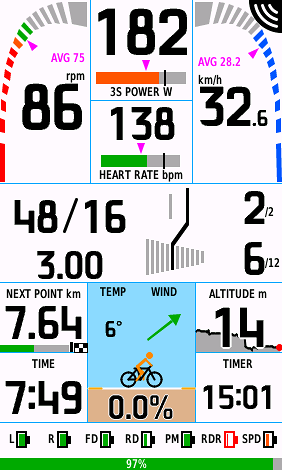

# Lazy Dashboard

[Connect IQ 商店](https://apps.garmin.com/apps/6b6fd786-e6ac-4419-9f56-75a55b97b7a3) · [English manual](README.md) · [한국어 설명서](README.ko.md) · [日本語マニュアル](README.ja.md)

機械式變速自行車請用 **[Lazy Dashboard – Mechanical](mechanical/README.zh-TW.md)**：由速度與踏頻推估檔位並顯示。



本儲存庫只有使用說明。問題與錯誤回報請寄信給開發者 [lazyfrmr@gmail.com](mailto:lazyfrmr@gmail.com)（可以使用中文）。

適用於 Garmin Edge 的 Connect IQ 資料欄位。一個畫面就能看到踏頻、速度、功率、心率、傳動系統（檔位與交叉鏈提示）、
風、坡度、海拔、路線導航，以及各零件的電量。已在 SRAM AXS 上驗證；Shimano Di2 支援檔位顯示（Garmin 不提供 Di2 的電量數值
給應用程式，因此無法顯示 Di2 電量）。

> **畫面語言：** 應用程式畫面支援繁體中文、英文、韓文、日文（繁體中文自 1.3.0 起）。設定 [語言] 為 [自動] 時跟隨裝置語言。
> 本說明書以畫面上的中文寫出顯示內容，例如 `溫度`。
>
> 選單名稱依照 Garmin 台灣 Edge 1040 中文使用手冊。依機型與軟體版本可能略有不同（Edge 530 / 830 的選單路徑請參考各機型手冊）。

---

## 1. 支援的裝置

| 裝置 | 版面 | Lazy Digits（大數字字型） |
|---|---|---|
| Edge 1040 / 1050 / 1060 | 完整 | 有 |
| Edge 550 / 850 | 完整 | 有 |
| Edge 1030 / 1030 Plus / 1030 Bontrager | 完整 | 無（系統數字） |
| Edge 540 / 840 | 精簡（數字為主） | 有 |
| Edge 530 / 830 | 精簡（數字為主） | 無（系統數字） |
| Edge 520 Plus | 精簡（數字為主） | 無（系統數字） |

- **Lazy Digits** 是內建於應用程式的數字字型。裝置語言設為亞洲語言（中文、韓文、日文、泰文）時，540/840、550/850、1040、
  1050、1060 只提供 Connect IQ 應用程式較小的固定大小數字字型；使用 Lazy Digits 後，無論哪種語言數字都維持大尺寸。其他機型在任何
  語言下數字都相同，使用系統字型。字型為開放授權（OFL）：https://github.com/bwchae/lazy-digits
- Edge 520 Plus 不提供變速資料給應用程式，因此無法顯示變速把電量（檔位可以顯示）。不支援初代 Edge 520 與 Edge 1000。
- 所需軟體版本：Edge 1040 **31.35 以上**，1050 / 850 / 550 **32.20 以上**。安裝時若要求軟體更新，請先用 Garmin Express
  或 Edge 的設定更新軟體，再重新安裝。

## 2. 安裝與更新

1. 在手機上安裝 Garmin 的 **Connect IQ** app，並與 Edge 連線。
2. 在 Connect IQ app 中搜尋 **Lazy Dashboard** 並安裝。
   商店：https://apps.garmin.com/apps/6b6fd786-e6ac-4419-9f56-75a55b97b7a3
3. 下次 Edge 與手機同步時，應用程式會傳送到 Edge。接著依第 3 章加入資料畫面。

Edge 與手機同步時會收到更新（若在 Connect IQ app 中關閉了自動更新，請在 app 中手動更新）。設定會保留。

**更新到 1.3.0 時：** 為了線上風況，此版本新增兩項權限（背景、通訊），商店會顯示為透過網路傳送/接收資料。
若 Connect IQ app 詢問是否允許存取，請點選 **允許**，更新才會安裝。允許視窗可能沒有寫出權限名稱
（Connect IQ app 的已知問題），指的就是這項權限。傳出的只有取整到約 5 km 的位置（每 10 分鐘經由手機送到
Open-Meteo），不含可識別您身分的資訊。可用設定 **線上風況** 關閉。

## 3. 加入資料畫面

**Edge 1040（及其他觸控機型）**
1. 選擇選單圖示 > **活動模式**，選擇一個模式。
2. 選擇 **資料畫面 > 新增 > 資料畫面**。
3. 用箭頭選擇 **1 個欄位的配置**，將欄位設為 **Connect IQ > Lazy Dashboard**。

**Edge 530 / 830**
1. 選擇 **選單 > 設定 > 活動模式**，選擇一個模式。
2. 選擇 **資料畫面 > 新增 > 資料畫面**。
3. 用箭頭選擇 **1 個欄位的配置**。
4. 在資料欄位類別中選擇 **Connect IQ > Lazy Dashboard**，再選擇完成。

> 請使用 **1 個欄位** 的資料畫面。放在多個欄位的畫面中，會顯示較小的簡易版面。

> **請保留一個平常使用的資料畫面。** 萬一 Connect IQ 資料欄位發生錯誤，Edge 會繼續記錄，但該欄位會停止到騎乘結束。
> 旁邊有平常的畫面，只要滑動就能繼續騎。

## 4. 第一次使用前

- **配對感測器** — 電子變速器（AXS / Di2）、功率計、心率帶必須在 Edge 的 **感測器** 清單中。
  Edge 1040：選單 > **感測器 > 新增感測器**。
- **輸入齒數** — 在 Edge 的變速感測器設定（檔位資訊）中輸入大盤與飛輪的齒數。未輸入時 Edge 會使用預設值，
  飛輪圖的大小會不正確（檔位數字與交叉鏈判斷都不受影響）。SRAM AXS D1 世代的 AXS app 沒有輸入欄，請直接在 Edge 上輸入。
  Di2 可以使用在 E-Tube 中設定的齒數。
- **第一次騎乘** — 每個檔位各使用一次，就會學習齒數（依每台自行車儲存），飛輪圖與變速提示會變得準確。
- **手機** — 風的資料經由手機取得（透過手機網路連線取得 Open-Meteo，或 Garmin Connect 送到 Edge 的天氣）。沒有手機時，
  風的區域會顯示 **未連手機**。騎乘中原本連線的手機斷線時，會變成紅色的 **手機斷線!** 方框；停留超過 5 分鐘後再出發、且手機
  已斷線 20 秒以上時，會出現一次 **全螢幕警告與提示音**（是不是把手機忘在休息的地方了？）。點一下螢幕或按返回即可關閉；
  不操作的話 Edge 會在一段時間後自動關閉。紅色 **手機斷線!** 會一直顯示到手機重新連線。一開始就沒帶手機出發時，
  不會有警告或提示音，只顯示灰色的 **未連手機**。

## 5. 設定

**活動模式 > 資料畫面 >（有 Lazy Dashboard 的畫面）> Connect IQ 資料欄位 > Lazy Dashboard**。
選擇項目會開啟數值清單，選擇後即儲存。也可以在手機的 Connect IQ app 中設定。

| 設定 | 預設值 | 說明 |
|---|---|---|
| 語言 | 自動 | 自動（裝置語言）/ English / 韓文 / 日文 / 繁體中文 |
| 功率欄位 / 海拔欄位 / 心率欄位 | 自動 | 該欄位顯示的項目（海拔欄位在 1.1.0 以前叫做 Balance cell）。自動會依感測器選擇（見下方）。也可以選 **NP**（標準化功率）：出發 30 秒後開始顯示，騎乘中重新啟動資料欄位會從頭計算 |
| 距離欄位 | 自動 | 下方左邊的距離欄位。沒有路線時顯示騎乘距離。路線導航中的 **自動**：騎乘時顯示下一個路線點（名稱與距離；路線沒有路線點時為目的地距離），停下時（等紅燈、休息）顯示目的地距離。也可以固定為 **騎乘距離 / 目的地距離 / 下一航點**。偏離路線（超過 30 m 持續 5 秒）時，除非固定為騎乘距離，否則會以橘色顯示 `偏離路線` 與回到路線的距離。導航中欄位下方有進度條（已騎部分為綠色，下一個路線點為白邊黑柱，終點為方格旗）。下一個路線點在 1 km 以內時以公尺顯示（數字後面有小的 m：「350m」；偏離路線距離、上方欄位的下一航點也一樣）。上方三個欄位（功率、海拔、心率欄位）也可以選騎乘距離、下一航點，自由搭配。上方欄位已顯示下一航點時，**自動**的距離欄位改顯示剩餘距離（路線沒有路線點時顯示騎乘距離），同一個距離不會出現兩次 |
| 檔位列 | 自動 | 傳動系統列。**自動**：有電子變速器（AXS / Di2）時顯示檔位，否則顯示累計。**累計**：騎乘距離、總升落差、kJ（做功；沒有功率計時為卡路里）。**關閉**：不顯示傳動系統列，由上下各列分配其高度 |
| 檔位數字 | 檔位 | 傳動系統列的大數字：**檔位**（`6/12`，最大的飛輪齒片為 1，與 Garmin 內建檔位資料欄位相同），或 **剩餘輕檔**（目前大盤／小盤還能再變輕的檔數；0 時為橘色） |
| FTP | 200 W | **請改成您自己的 FTP。** 功率顏色（區間）與閾值刻度的基準。手機上可設定 50–600 W 的任意值；Edge 選單中可在目前值 ±75 W 內以 5 W 為單位選擇（在清單末端重新開啟可再往外調整） |
| 踏頻 紅色基準 | 65 rpm | 低於此值顯示紅色；也是輕檔提示的基準 |
| 踏頻 綠色起點 / 終點 | 70 / 95 rpm | 目標踏頻範圍 |
| 速度錶最大值 | 60 km/h | 速度弧形刻度的最大值 |
| 交叉鏈警示 / 飛輪片數 | 開啟 / 2 | 大盤配最大的 2 片、小盤配最小的 2 片視為交叉鏈 |
| 變速提示時機 | 3 秒 | 交叉鏈持續這段時間後顯示綠色提示 |
| 交叉鏈彈出提示 | 10 秒後 | 持續較久時跳出提示；0 = 關閉 |
| 輕檔提示 | 開啟 | 踏頻教練（見下方） |
| 藍牙電量掃描 | 開啟 | 讀取 AXS 的電量 %；關閉可省電 |
| 線上風況 | 開啟 | 每 10 分鐘經由手機從 Open-Meteo 取得風況與溫度（位置以約 5 km 為單位取整數）。關閉時只使用 Garmin 的天氣，不連網路 |
| FIT 記錄 | 開啟 | **開啟**：將交叉鏈時間與變速零件型號記錄到活動的 FIT 檔案（2 個欄位）。**開啟＋電量**：也記錄各零件電量（再加 10 個欄位）。**關閉**：不記錄。Garmin 限制一個活動可使用的開發者欄位數，由該活動中所有 Connect IQ 資料欄位共用，因此同時使用多個會記錄的資料欄位時，Lazy Dashboard 可能一開始就停止。這時請關閉此項（下次資料欄位啟動時生效） |
| 電池顯示 | 所有感測器 | 選 `僅變速器與功率計` 時只顯示變速把、變速器與功率計，隱藏雷達、速度、踏頻感測器（圖示變大）。FIT 記錄不變 |

**自動欄位的規則**
上方的表現區（第 1–2 列）會依連線的感測器自動配置（功率欄位與心率欄位都是自動時）：
- 左側（弧形）：踏頻 → 沒有則 3 秒功率 → 沒有則心率 → 都沒有則只放大顯示速度。
- 中央：沒有放在左側的功率、心率。只有一個時下方顯示總升落差（累計列已有總升落差時改為平均速度）；兩者都沒有時顯示
  平均速度（有踏頻感測器時加上平均踏頻）與總升落差。
- 出發後 90 秒內沿用上次騎乘的感測器配置，避免感測器連線期間畫面跳動。
- 功率與踏頻一旦出現，會保留位置直到騎乘結束（下坡 0 W 也一樣）。心率超過 1 分鐘沒有數值（取下心率帶、關閉手錶心率廣播）
  會讓出位置，Edge 重新連線後再回來。
- 海拔欄位：海拔。（所有機型的坡度都顯示在下方的姿態儀。）

## 6. 畫面說明

### 完整版面（1040、1030、1050、1060、550、850）
```
 踏頻弧形    | 3秒功率 W  ###o  | 速度弧形
    88 rpm   | 心率 bpm   #o#   |  32.5 km/h
 ---------------------------------------------
 檔位
   6 /12      飛輪圖 + 箭頭
 大盤
 ---------------------------------------------
 距離+軌跡 | 姿態儀（坡度）+ 風 | 海拔+剖面圖
 時間      |                    | 計時器
 ---------------------------------------------
 L R FD RD PM 電量        （最下方：Edge 本身電量 %）
```
- **踏頻與速度弧形** — 由外往內填滿。踏頻顏色：紅（偏低）/ 橘 / 綠（目標）。弧形內側的洋紅色三角形 = 本次騎乘平均，
  大數字下方也有洋紅色數字（「平均 29.9」）。
  **停下時**（等紅燈、休息、計時器暫停），踏頻、速度、功率的大數字會改為本次平均，單位標上 `平均`；功率標題會加上目前為止的
  NP（「平均 W | NP 163」）。心率維持即時值，方便觀察恢復情形。
  平均速度欄位（例如沒有功率與心率感測器時）停下時會與速度錶重複，因此改為顯示已停止多久（`停止時間`），方便控制休息時間。
- **3 秒功率與心率** — 大數字下方長條的顏色是目前區間（藍、綠、橘、紅、紫）；刻度是 FTP（心率為閾值）；長條上方的洋紅色
  三角形是平均。
- **姿態儀** — 上坡時地面向右升起（放大 3 倍）；下方的數字是坡度 %，往地面較深的一側偏移。兩側的黃色水平刻度只在沒有被
  地面蓋住的一側顯示（接近水平時兩側都顯示）。
- **溫度與風** — 天空左側的 `溫度` 是您所在位置的 Open-Meteo 氣溫（離地 2 m 的模型值，與風況一起取得；沒有新資料時為
  手機的 Garmin 天氣），右側的 `風` 是以行進方向為基準的箭頭。Connect IQ 應用程式無法讀取 Edge 本身的溫度感測器，
  因此可能與 Edge 內建溫度資料欄位不同（該感測器在太陽下停留時也會偏高）。
- **騎士（橘色）** — 踩踏時雙腳每秒交替。停下時騎士放下左腳；停超過 5 分鐘（比紅燈久）會下車坐在椅子上翹腳。
- **風** — 上方 = 行進方向。騎士上方天空中的箭頭指向風吹去的方向，風越強箭頭越粗。紅色逆風 / 橘色側風 / 綠色順風。
  粗細依體感風而定：同時參考平均風與陣風（Open-Meteo；Garmin 天氣沒有陣風，只用平均風），逆風時最粗，側風・順風
  稍細，道路轉彎時會慢慢變化。不顯示風速數字：只看平均風會比體感弱。低於 1.5 m/s（微風）時，以青綠色的 **圓圈內小箭頭** 顯示。
  風來自 **Open-Meteo**（設定「線上風況」，預設開啟）：Edge 每 10 分鐘經由手機取得您所在位置的模型風況。沒有新資料時
  （手機沒有網路，或關閉設定）改用 Garmin 的天氣：附近一個觀測站約每小時更新一次的平均風，常常落後於體感。兩者都不是在測量
  您騎乘中遇到的陣風。風況資料：[Open-Meteo.com](https://open-meteo.com/)（CC BY 4.0）。
- **預計抵達時間** — 依路線導航時，時間欄位的標題會變成預計抵達時間（`抵達 15:56`）：以本次騎乘的平均速度騎完剩餘距離來
  計算，騎滿 1 km 後才顯示。不包含之後的休息時間。

### 精簡版面（530、830、540、840）
上方以數字為主（踏頻 | 速度、功率 | 心率、傳動系統），下方是與完整版面相同的環境面板（距離 / 時間 | 姿態儀 + 風 |
海拔 / 計時器）。時間放在左側，是為了不讓 Edge 右側邊緣的雷達條擋住分鐘數字；計時器超過 1 小時改為時:分顯示（標題
`計時器 h:mm`），數字不會變小。姿態儀為單色（只有地面是灰色），數字更清楚，只有風的箭頭有顏色。踏頻數字以範圍顏色顯示。

### 傳動系統（所有機型）
- **檔位數字**（左）— `檔位 6/12`：12 片飛輪中從最大的一片數起的第 6 片（與 Garmin 內建檔位資料欄位、FIT 檔案的編號相同）。
  設定 **檔位數字 = 剩餘輕檔** 時，改為顯示目前大盤／小盤還能再變輕的檔數（`剩餘輕檔 2`；0 時為橘色 — 該換小盤了）。
- **大盤／小盤名稱**（數字下方）— 前齒盤 2 片時顯示 `大盤` / `小盤`。出現變速提示時，該位置改為提示。
- **飛輪圖**（右）— 從上方看的齒盤（上）與飛輪（下），鏈條連接目前的檔位。所有檔位各使用一次後，長條會變成實際齒數的大小。
  交叉鏈時，數字與斜的鏈條變成紅色。
- **綠色箭頭 + `換到綠色檔位`** — 交叉鏈。請換到以綠色標示的檔位。
- **橘色箭頭 + `換輕檔`** — 在上坡（坡度 2 % 以上）或強逆風中，踏頻低於紅色基準已持續 8 秒。請換輕一檔；變速後重新計算
  8 秒。有功率計時只在出力時（FTP 的 60 % 以上）提示，逆風只在連續騎乘 2 分鐘以上時提示。平地市區騎乘、起步與等紅燈時
  不會出現。

在分成多個欄位的畫面（較小的版面）中，也會顯示相同的檔位數字、大盤／小盤名稱與提示。

### 機械變速系統
Garmin 只會把電子變速器（AXS、Di2 等 ANT+ 變速規格）的檔位提供給應用程式。不是電子變速時，**檔位列 = 自動** 會改為顯示
**累計**：騎乘距離 | 總升落差 | kJ（沒有功率計時為卡路里）。出現輕檔提示時（需要踏頻），第三格會變成橘色的 `換輕檔`。
設為 **檔位列 = 關閉**，該列的高度會分給上方的數字與下方的面板。

### 電量
- 零件：**L、R** 左右變速把，**FD、RD** 前後變速器，**PM** 功率計，**RDR** 雷達（含雷達尾燈），**SPD** 速度感測器，
  **CAD** 踏頻感測器。
- 不需設定：只有與 Edge 配對 **且目前已連線** 的感測器才會出現欄位。
- 欄位不夠時，狀態良好的零件會合併為右側的一個 **`OK 6`**（反白方框，數字 = 個數），只有需要注意的零件保留各自的欄位。
- 灰色 **`?`**：本次騎乘（或 10 分鐘內結束的上次騎乘）曾連線的感測器現在不見了 — 可能已關機或電池沒電。
- 顏色：綠色良好 / 橘色普通 / 紅色需更換。騎乘時顯示圖示，停下時顯示電壓 / %。
- 無法讀取：心率帶、僅支援藍牙的感測器、Di2 — 請在 Edge 的感測器頁面確認。
- 最下方長條：**Edge 本身的電量** %。30 % 以上為綠色，15 % 以上為橘色，以下為紅色。
- Di2：會顯示 `Di2 電量請看 Edge 感測器頁面` — 請在 Garmin 內建的感測器頁面確認 Di2 電量。其他感測器的電量優先使用空間，
  空間不足時提示會縮短為 `Di2: Edge` 或不顯示。

## 7. 疑難排解

| 狀況 | 請確認 |
|---|---|
| 無法安裝 / 出現軟體更新提示 | Edge 的軟體版本（第 1 章）；更新後再重新安裝 |
| Connect IQ 清單中找不到 | Edge 是否已與手機同步（Connect IQ app 中是否仍在等待安裝） |
| 收不到更新 / 停在等待中 | 打開手機的 Connect IQ app：若詢問是否允許存取（1.3.0 為風況新增網路權限，第 2 章），請允許並在 app 中更新。仍不行時，用電腦的 Garmin Express 同步 Edge |
| 下一個路線點顯示路名 | 開啟轉彎提示時，路口轉彎會成為「下一個點」。只想看路線點時請關閉轉彎提示 |
| 路線點名稱被截斷 | Garmin Connect 只儲存名稱的 16 bytes（中文約 5 個字）；請取短一點的名稱 |
| 顯示小的版面 | 是否放在 1 個欄位的配置 |
| 沒有檔位 | 電子變速：配對變速感測器。機械變速：請見「機械變速系統」 |
| 飛輪圖大小不正確 | 在 Edge 的感測器設定中輸入齒數，然後每個檔位各使用一次 |
| 風顯示 `--` | 手機是否已連線；車速是否超過 5 km/h（需要行進方向） |
| 汗水或雨水讓欄位換成別的項目 | 觸控螢幕誤判為長按。流汗多或下雨時請鎖定觸控螢幕（Edge 使用手冊「鎖定觸控螢幕」）：活動期間按下 **電源鍵** 即可鎖定 / 解鎖，其他時候長按電源鍵並選擇 **鎖定螢幕**。鎖定時按鍵照常可用。在資料畫面編輯中把欄位改回 Lazy Dashboard |
| 一開始就只剩 IQ 標誌（同時使用其他 Connect IQ 資料欄位） | 多個資料欄位用完了一個活動的 FIT 開發者欄位上限。請在設定中關閉 **FIT 記錄**，或減少該活動模式中的其他 Connect IQ 資料欄位 |
| 騎乘中只剩 IQ 標誌 | 資料欄位因錯誤停止。騎乘仍在記錄：滑到平常的畫面繼續騎。不結束騎乘也能恢復，請見下方「騎乘中重新啟動」。請把 `Garmin\Apps\LOGS\` 中的 `CIQ_LOG` 檔案（`.YML` 或 `.BAK`）寄給開發者 |
| 欄位空白或變成藍色 | 請告知開發者（附上裝置與畫面照片） |

### 騎乘中重新啟動
資料欄位停止、只剩 IQ 標誌時，不必停止記錄也能讓 Lazy Dashboard 恢復：打開資料畫面編輯，**不做任何變更** 直接返回。

| 裝置 | 路徑 |
|---|---|
| Edge 1040、840、540、550、850 | 選單圖示 > **活動模式** >（目前的模式）> **資料畫面** >（Lazy Dashboard 的畫面）> **欄位配置與資料欄位** |
| Edge 1050、1060 | 選單圖示 > **活動模式** >（目前的模式）> **資料畫面** >（左右滑到 Lazy Dashboard 的畫面）> 設定（齒輪）圖示 > **編輯資料欄位** |
| Edge 530、830 | **選單 > 設定 > 活動模式** >（目前的模式）> **資料畫面** >（Lazy Dashboard 的畫面）> **欄位配置與資料欄位** |

- 觸控機型：點一下螢幕開啟選單，在配置畫面按幾次 **返回** 回到騎乘。
- 按鍵機型（530、540 等）：用按鍵開啟選單，依相同路徑進入後以返回鍵離開。在配置畫面上下鍵會變更配置，請只按返回。
- 已在 Edge 1040 上驗證；其他機型應該相同（資料畫面會重新載入）。
- 重新啟動後，Edge 計算的數值（距離、平均、總升落差）會延續；儀表板自己收集的資料（軌跡草圖、感測器記錄）從該時間點重新開始。
