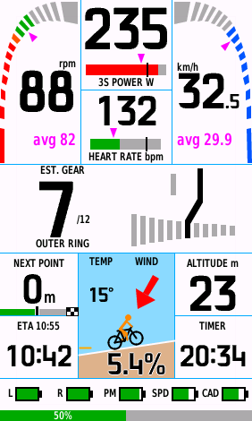

# Lazy Dashboard – Mechanical ユーザーマニュアル

[English manual](README.md) · [한국어 설명서](README.ko.md) · [繁體中文說明](README.zh-TW.md)

ご質問・不具合のご報告は開発者のメール [lazyfrmr@gmail.com](mailto:lazyfrmr@gmail.com) までお送りください。

**電動変速のない自転車**のための Lazy Dashboard です。Lazy Dashboard の1画面コックピットと同じで、違いは1つだけです：
ドライブトレインの欄に、スピードとケイデンスから計算した **推定ギア** が出ます。そのほかの機能（ケイデンス・スピードの
メーター、パワー、心拍、勾配、風、コース、バッテリー）は [Lazy Dashboard マニュアル](https://github.com/bwchae/lazy-dashboard)
と同じで、このページでは違う点だけを説明します。

SRAM AXS や Shimano Di2 なら、実際のギアを読む Lazy Dashboard をお使いください。

## 1. 準備
1. Connect IQ ストアからインストールし、**Lazy Dashboard – Mechanical** を **分割数1** のトレーニングページに置きます
   （機種ごとのメニュー：Lazy Dashboard マニュアル 3章「トレーニングページに追加する」）。
2. 項目の設定を開く：Edge で **ライドプロフィール**（530/830 は **アクティビティプロフィール**）＞ **トレーニングページ** ＞
   （そのページ）＞ **Connect IQ データ項目の設定** ＞ **Lazy Dashboard – Mechanical**（またはスマートフォンの Connect IQ アプリ）。
3. 自転車に合わせて **チェーンリング** と **カセット** を選びます。カセットが **オフ** のあいだは推定しません。
4. **ケイデンス** をつなぎます（ケイデンスセンサーかパワーメーター）。スピードセンサーがあればより良く、GPS 速度でも動きます。

## 2. Lazy Dashboard と違う設定

| 設定 | 初期値 | 内容 |
|---|---|---|
| ギア欄 | 自動 | **自動**：カセットを選ぶと推定ギア、なければ合計。**推定ギア**：電動変速があっても推定を表示（比較用）。**合計**：距離・獲得標高・kJ。**オフ**：ドライブトレインの欄なし |
| チェーンリング | 50/34 | 2枚（50/34、52/36、53/39、50/37、48/35、46/33、43/30、48/31、46/30）または 1x の1枚（38〜46） |
| カセット | オフ | カセット（8〜12速）。**オフ** = 推定しない |
| FIT記録 | オン | アクティビティファイルに1項目（下記）。ほかの Connect IQ 項目も記録するときはオフに |

## 3. 推定ギア
- ドライブトレインの欄に **リアのギア段**（`7/12`、1 = いちばん大きいコグ）、**チェーンリング**（`アウター` / `インナー`）、
  上から見たスプロケット図が出ます。見出しは `推定ギア` です。
- **黒**（夜間は白）= 確信、**グレー** = 推定中：2枚のチェーンリングにはギア比がほぼ同じ組み合わせがあります（48×19 と 35×14 は
  1 % 差）。クロスチェーンの赤と変速の案内は確信のときだけ出ます。
- ホイールの大きさは走りながら合わせます（700c、タイヤ約 25〜45 mm）。スピードセンサーがあれば、Edge がそのセンサーに使う
  大きさから始めます。安定してペダルを回すまでは何も出ず、スタート後の数分はたいていグレーです。
- 足を止めて下るときと変速直後の数秒は読み取れないため、その間は直前の推定が残ります。
- **どのくらい当たる？** 作者の電動変速の自転車の記録で、実際のギアと1秒ごとに比べました：スピードセンサーありで約 **85 %**
  （34回）、GPS 速度のみで **83 %**（7回）、確信の表示では約 **90 %**。チェーンリング・カセット・センサー・走り方で変わります。
- ほぼずっとグレーなら、チェーンリングかカセットの設定が自転車と合っていない可能性が高いです。

## 4. FIT記録
**FIT記録** がオンなら、アクティビティファイルの毎秒の記録に開発者フィールドが1つ入ります。
- `est_gear`：cross << 14 | ring << 8 | cog << 1 | sure（ring 0 = インナー、cog 0 = いちばん大きいコグ、cross = クロスチェーン中は 1；
  65535 = 推定なし）

1つのアクティビティに記録できる Connect IQ 項目の枠は多くありません。ほかの Connect IQ データ項目も使っていて、スタート直後に
IQ ロゴだけになる場合は、ここかほかの項目で **FIT記録** をオフにしてください。

## 5. 困ったとき
| 症状 | 原因 / 対処 |
|---|---|
| `推定ギア` にダッシュだけ | まだケイデンスがないか停止中：しばらく一定にペダルを回してください |
| ギアの代わりに合計 | カセットが **オフ**、またはケイデンスの入力がない |
| ずっとグレー | チェーンリング・カセットの設定が自転車と違う |
| スタート直後に IQ ロゴ | 記録する Connect IQ 項目が多すぎる：**FIT記録** をオフ（4章） |

そのほかは [Lazy Dashboard マニュアル](https://github.com/bwchae/lazy-dashboard) をご覧ください。
