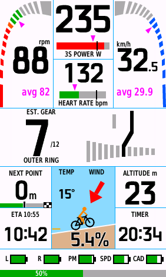

# Lazy Dashboard – Mechanical 사용 설명서

[English manual](README.md) · [日本語マニュアル](README.ja.md) · [繁體中文說明](README.zh-TW.md)

질문·문제 제보는 개발자 이메일 [lazyfrmr@gmail.com](mailto:lazyfrmr@gmail.com)로 보내 주세요.

**전자식 변속기가 없는 자전거**를 위한 Lazy Dashboard입니다. Lazy Dashboard의 한 화면 대시보드와 같고, 다른 점은
하나입니다: 구동계 줄에 속도와 케이던스로 계산한 **추정 기어**가 나옵니다. 그 밖의 기능(케이던스·속도 클러스터, 파워, 심박,
경사, 바람, 코스, 배터리)은 [Lazy Dashboard 설명서](https://github.com/bwchae/lazy-dashboard)와 같고, 이 문서는 다른 점만
다룹니다.

SRAM AXS나 시마노 Di2라면 실제 기어를 읽는 Lazy Dashboard를 쓰세요.

## 1. 준비
1. Connect IQ 스토어에서 설치하고, **Lazy Dashboard – Mechanical**을 **1칸** 레이아웃 데이터 화면에 넣습니다
   (기기별 메뉴 경로: Lazy Dashboard 설명서 3장 "데이터 화면에 추가").
2. 필드 설정 열기: Edge에서 **액티비티 프로파일 > (프로필) > 데이터 화면 > (그 화면) > Connect IQ 데이터 필드 >
   Lazy Dashboard – Mechanical** (또는 휴대폰 Connect IQ 앱).
3. 자전거에 맞게 **체인링**과 **카세트**를 고릅니다. 카세트가 **끄기**이면 추정하지 않습니다.
4. **케이던스**를 연결합니다(케이던스 센서나 파워미터). 속도 센서가 있으면 더 좋고, GPS 속도로도 됩니다.

## 2. Lazy Dashboard와 다른 설정

| 설정 | 기본값 | 설명 |
|---|---|---|
| 기어 줄 | 자동 | **자동**: 카세트를 고르면 추정 기어, 아니면 합계. **추정 기어**: 전자식 변속기가 있어도 추정을 보여 줌(비교용). **합계**: 거리·획득고도·kJ. **끄기**: 구동계 줄 없음 |
| 체인링 | 50/34 | 체인링 두 장(50/34, 52/36, 53/39, 50/37, 48/35, 46/33, 43/30, 48/31, 46/30) 또는 1x 한 장(38~46) |
| 카세트 | 끄기 | 카세트(8~12단). **끄기** = 추정 안 함 |
| FIT 기록 | 켜기 | 활동 파일에 한 칸(아래). 다른 Connect IQ 필드도 기록할 때는 끄세요 |

## 3. 추정 기어
- 구동계 줄에 **뒤 기어 단**(`7/12`, 1 = 가장 큰 코그), **체인링**(`아우터` / `이너`), 위에서 본 스프라켓 그림이 나오고,
  제목은 `추정 기어`입니다.
- **검정**(야간 흰색) = 확신, **회색** = 추정 중: 두 체인링에는 기어비가 거의 같은 조합이 있습니다(48×19와 35×14는 1 % 차이).
  크로스체인 빨강과 변속 안내는 확신일 때만 나옵니다.
- 바퀴 크기는 달리면서 맞춥니다(700c, 타이어 약 25~45 mm). 속도 센서가 있으면 Edge가 그 센서에 쓰는 크기에서 시작합니다.
  처음 고르게 페달을 밟을 때까지는 아무것도 나오지 않고, 출발 후 몇 분은 대개 회색입니다.
- 페달을 멈추고 내려갈 때와 변속 직후 몇 초는 읽을 수 없어 그동안은 직전 추정이 남습니다.
- **얼마나 맞나요?** 작성자의 전자식 자전거 기록에서 실제 기어와 1초마다 비교했더니, 속도 센서가 있으면 약 **85 %**(34회),
  GPS 속도만으로 **83 %**(7회), 확신으로 표시될 때는 약 **90 %** 맞았습니다. 체인링·카세트·센서·주행 습관에 따라 달라집니다.
- 거의 늘 회색이면 체인링이나 카세트 설정이 자전거와 다를 가능성이 큽니다.

## 4. FIT 기록
**FIT 기록**이 켜져 있으면 활동 파일의 매 기록에 개발자 필드 한 칸이 들어갑니다.
- `est_gear`: cross << 14 | ring << 8 | cog << 1 | sure (ring 0 = 이너, cog 0 = 가장 큰 코그; cross = 크로스체인 중이면 1;
  65535 = 추정 없음)

활동 하나에 기록할 수 있는 Connect IQ 필드 칸은 많지 않습니다. 다른 Connect IQ 데이터 필드도 쓰는데 시작하자마자 IQ 로고만
나오면, 여기나 다른 필드에서 **FIT 기록**을 끄세요.

## 5. 문제 해결
| 증상 | 원인 / 할 일 |
|---|---|
| `추정 기어`에 대시만 나옴 | 아직 케이던스가 없거나 서 있는 중: 잠시 고르게 페달을 밟으세요 |
| 기어 대신 합계가 나옴 | 카세트가 **끄기**이거나 케이던스 소스가 없음 |
| 늘 회색 | 체인링·카세트 설정이 자전거와 다름 |
| 시작하자마자 IQ 로고 | 기록하는 Connect IQ 필드가 너무 많음: **FIT 기록** 끄기(4장) |

나머지는 [Lazy Dashboard 설명서](https://github.com/bwchae/lazy-dashboard)를 보세요.
