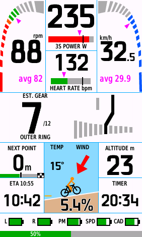

# Lazy Dashboard – Mechanical — user manual

[한국어 설명서](README.ko.md) · [日本語マニュアル](README.ja.md) · [繁體中文說明](README.zh-TW.md)

Questions and bug reports: e-mail the developer at [lazyfrmr@gmail.com](mailto:lazyfrmr@gmail.com).

Lazy Dashboard for bikes **without electronic shifting**. It is Lazy Dashboard's one-screen cockpit with one
difference: the drivetrain row shows the **estimated gear**, worked out from speed and cadence. Everything else
(cadence and speed cluster, power, heart rate, grade, wind, course, batteries) works as in the
[Lazy Dashboard manual](https://github.com/bwchae/lazy-dashboard) — this page covers only what is different.

Riding SRAM AXS or Shimano Di2? Use Lazy Dashboard: it reads the real gear.

## 1. Set up
1. Install from the Connect IQ Store and add **Lazy Dashboard – Mechanical** to a data screen with **one field**
   (menu paths per Edge: Lazy Dashboard manual, section 3 "Add it to a data screen").
2. Open the field's settings: on the Edge, **Activity Profiles > (profile) > Data Screens > (that screen) >
   Connect IQ Data Fields > Lazy Dashboard – Mechanical** (or in the Connect IQ phone app).
3. Set **Chainrings** and **Cassette** for your bike. Nothing is estimated while the cassette is **Off**.
4. Pair a **cadence** source (cadence sensor or power meter). A speed sensor helps; GPS speed works too.

## 2. Settings that differ from Lazy Dashboard

| Setting | Default | What it does |
|---|---|---|
| Gear row | Auto | **Auto**: the estimated gear once a cassette is set, otherwise Totals. **Estimated gear**: the estimate even with electronic shifting (for comparing). **Totals**: distance, ascent, kJ. **Off**: no drivetrain row |
| Chainrings | 50/34 | Your chainrings: two rings (50/34, 52/36, 53/39, 50/37, 48/35, 46/33, 43/30, 48/31, 46/30) or one ring on 1x (38-46) |
| Cassette | Off | Your cassette (8 to 12 speeds). **Off** = no estimate |
| Record to FIT | On | One field in the activity file (below). Turn off when other Connect IQ fields record too |

## 3. The estimated gear
- The row shows the **rear gear number** (`7/12`, 1 = largest cog), the **chainring** (`OUTER RING` / `INNER RING`)
  and a top-down sprocket chart, labelled `EST. GEAR`.
- **Black** (white at night) = sure, **grey** = a guess: some gears on the two chainrings are almost the same
  (48x19 and 35x14 differ by 1 %). Cross-chain red and the shift hints only appear while it is sure.
- The wheel size is learned while riding (700c, tyres of about 25-45 mm); with a speed sensor it starts from the size
  the Edge uses for that sensor. Nothing shows until the first steady pedalling, and the first minutes are mostly grey.
- Coasting and the seconds after a shift can't be read; the last estimate stays meanwhile.
- **How good is it?** Checked second by second against the real gear on the author's electronically shifted bikes:
  right about **85 %** of the time with a speed sensor (34 rides), **83 %** on GPS speed only (7 rides), and about
  **90 %** while shown as sure. Your chainrings, cassette, sensors and riding change this.
- Almost always grey? The chainrings or cassette setting is probably wrong for the bike.

## 4. FIT recording
With **Record to FIT** on, one developer field goes into every record of the activity file:
- `est_gear`: cross << 14 | ring << 8 | cog << 1 | sure (ring 0 = inner, cog 0 = largest; cross = 1 while cross-chained;
  65535 = no estimate)

An activity has room for only a few Connect IQ fields' records. If the field shows only the IQ logo right at the
start and you use other Connect IQ data fields too, turn **Record to FIT** off here or in those fields.

## 5. Troubleshooting
| What you see | Why / what to do |
|---|---|
| `EST. GEAR` with dashes | No cadence yet, or still standing: pedal steadily for a moment |
| Totals instead of the gear | Cassette **Off**, or no cadence source |
| Always grey | Chainrings / cassette setting doesn't match the bike |
| IQ logo at start | Too many Connect IQ fields recording: turn **Record to FIT** off (section 4) |

Everything else: [Lazy Dashboard manual](https://github.com/bwchae/lazy-dashboard).
