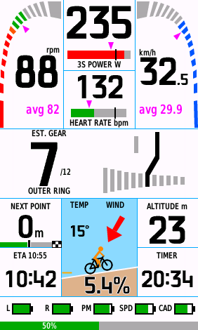

# Lazy Dashboard – Mechanical 使用手冊

[English manual](README.md) · [한국어 설명서](README.ko.md) · [日本語マニュアル](README.ja.md)

問題與錯誤回報請寄信給開發者 [lazyfrmr@gmail.com](mailto:lazyfrmr@gmail.com)。

給 **沒有電子變速的自行車** 使用的 Lazy Dashboard。與 Lazy Dashboard 的一頁式儀表板相同，只有一處不同：傳動系統列會顯示
由速度與踏頻算出的 **推估檔位**。其他功能（踏頻・速度儀表、功率、心率、坡度、風、路線、電量）請見
[Lazy Dashboard 使用手冊](https://github.com/bwchae/lazy-dashboard)，本文只說明不同之處。

使用 SRAM AXS 或 Shimano Di2 的話，請改用讀取實際檔位的 Lazy Dashboard。

## 1. 準備
1. 從 Connect IQ 商店安裝，把 **Lazy Dashboard – Mechanical** 放到 **單一欄位** 版面的資料畫面
   （各機型選單路徑：Lazy Dashboard 使用手冊第 3 章「加入資料畫面」）。
2. 開啟欄位設定：在 Edge 上 **活動模式 > 資料畫面 >（該畫面）> Connect IQ 資料欄位 > Lazy Dashboard – Mechanical**
   （或手機的 Connect IQ app）。
3. 依自行車選擇 **大盤** 與 **飛輪**。飛輪為 **關閉** 時不會推估。
4. 連接 **踏頻**（踏頻感測器或功率計）。有速度感測器更好，只有 GPS 速度也可以。

## 2. 與 Lazy Dashboard 不同的設定

| 設定 | 預設 | 說明 |
|---|---|---|
| 檔位列 | 自動 | **自動**：選了飛輪就顯示推估檔位，否則顯示累計。**推估檔位**：有電子變速也顯示推估（用於比對）。**累計**：距離・總升・kJ。**關閉**：不顯示傳動系統列 |
| 大盤 | 50/34 | 兩片（50/34、52/36、53/39、50/37、48/35、46/33、43/30、48/31、46/30）或 1x 單片（38～46） |
| 飛輪 | 關閉 | 飛輪（8～12 速）。**關閉** = 不推估 |
| FIT 記錄 | 開啟 | 活動檔中一個欄位（見下）。其他 Connect IQ 欄位也在記錄時請關閉 |

## 3. 推估檔位
- 傳動系統列顯示 **後檔位置**（`7/12`，1 = 最大齒片）、**大盤**（`大盤` / `小盤`）與由上往下看的飛輪圖，標題為 `推估檔位`。
- **黑色**（夜間為白色）= 確定，**灰色** = 推估中：兩片大盤有齒比幾乎相同的組合（48×19 與 35×14 只差 1 %）。
  交叉鏈條的紅色與換檔提示只在確定時出現。
- 輪徑會在騎乘中自動校正（700c，胎寬約 25～45 mm）。有速度感測器時，從 Edge 為該感測器設定的輪徑開始。
  在第一次穩定踩踏之前不會顯示，出發後的幾分鐘大多是灰色。
- 停止踩踏滑行時與換檔後幾秒無法判讀，這段時間會保留上一個推估。
- **準確度如何？** 在作者的電子變速自行車紀錄中逐秒與實際檔位比對：有速度感測器約 **85 %**（34 趟），只用 GPS 速度
  **83 %**（7 趟），顯示為確定時約 **90 %**。會因大盤、飛輪、感測器與騎乘習慣而不同。
- 幾乎一直是灰色時，很可能是大盤或飛輪設定與自行車不符。

## 4. FIT 記錄
**FIT 記錄** 開啟時，活動檔的每筆紀錄會寫入一個開發者欄位：
- `est_gear`：cross << 14 | ring << 8 | cog << 1 | sure（ring 0 = 小盤，cog 0 = 最大齒片，cross = 交叉鏈條時為 1；
  65535 = 沒有推估）

一個活動能記錄的 Connect IQ 欄位空間不多。若同時使用其他 Connect IQ 資料欄位，而一開始就只剩 IQ 標誌，請在這裡或其他欄位
關閉 **FIT 記錄**。

## 5. 疑難排解
| 現象 | 原因 / 處理 |
|---|---|
| `推估檔位` 只有橫線 | 還沒有踏頻或正在停車：穩定踩踏一會兒 |
| 顯示累計而不是檔位 | 飛輪為 **關閉**，或沒有踏頻來源 |
| 一直是灰色 | 大盤・飛輪設定與自行車不符 |
| 一開始就是 IQ 標誌 | 記錄的 Connect IQ 欄位太多：關閉 **FIT 記錄**（第 4 章） |

其他內容請見 [Lazy Dashboard 使用手冊](https://github.com/bwchae/lazy-dashboard)。
